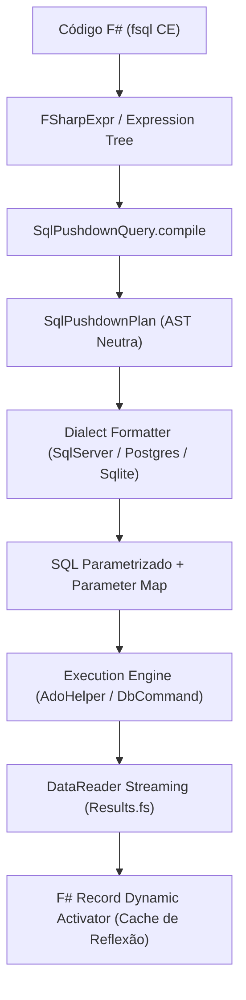

# Especificação da Linguagem FSQL (F# Structured Query Language)
## Especificação Técnica Interna de Arquitetura e Compilação DQL

**Versão da Especificação:** 1.0.0  
**Status:** Canônica / Ativa  
**Escopo:** Motores Relacionais SQL (SQL Server, PostgreSQL, SQLite, MySQL, MariaDB, Oracle) e Provedores Analíticos em Memória  
**Data:** Novembro de 2026  

---

## 1. Visão Geral e Propósito

### 1.1 Definição
O **FSQL** (F# Structured Query Language) é uma linguagem de consulta de dados declarativa, fortemente tipada e integrada nativamente ao F# através de *Computation Expressions* e árvores de expressão (*Expression Trees / Quotations*). O FSQL atua como uma especificação abstrata de Data Query Language (DQL), projetada para traduzir consultas de alto nível diretamente em comandos SQL nativos e altamente otimizados (SQL Pushdown), preservando segurança contra injeção de SQL, performance de execução e inferência estática de tipos.

### 1.2 Princípios Fundamentais
1. **Type Safety & Intellisense**: Toda consulta FSQL é verificada em tempo de compilação contra os metadados do esquema do banco de dados, eliminando erros comuns em tempo de execução como digitação incorreta de colunas ou incompatibilidade de tipos.
2. **Pushdown Universal**: Toda operação de filtro, junção, projeção, ordenação, agrupamento e paginação é enviada ao motor do banco de dados relacional. Apenas as colunas projetadas e as linhas estritamente solicitadas trafegam pela rede ou são carregadas em memória.
3. **Imutabilidade e Segurança**: Prevenção estrita e garantida contra SQL Injection através da parametrização obrigatória de todos os literais e variáveis dinâmicas capturadas em escopo.
4. **Independência de Dialeto (Dialect Agnostic)**: A mesma consulta FSQL expressa na sintaxe canônica executa de forma idêntica sobre **SQL Server**, **PostgreSQL**, **SQLite**, **MySQL** ou arquivos tabulares cacheados, gerando o SQL idiomático correspondente a cada dialeto.

---

## 2. Gramática Formal e Sintaxe Canônica

A sintaxe canônica do FSQL é definida através da computation expression `fsql { ... }`.

### 2.1 EBNF (Extended Backus-Naur Form)

```ebnf
FSqlQueryExpression ::=
    "fsql" "{"
        SourceIterationClause
        { JoinClause | ApplyClause }
        { WhereClause | ExistsClause }
        [ GroupByClause ]
        [ HavingClause ]
        [ OrderByClause ]
        [ LimitOffsetClause ]
        SelectClause
    "}"
    | "fsql" "{"
        SourceIterationClause
        TerminalAggregateClause
      "}" ;

SourceIterationClause ::=
    "for" Identifier "in" QuerySource "do" ;

QuerySource ::=
    QualifiedIdentifier | NestedFSqlExpression ;

WhereClause ::=
    "where" "(" BooleanExpression ")" ;

ExistsClause ::=
    ( "whereExists" | "whereNotExists" ) "(" NestedFSqlExpression ")" ;

JoinClause ::=
    "join" Identifier "in" QuerySource "on" "(" KeyExpression "=" KeyExpression ")"
    | "leftOuterJoin" Identifier "in" QuerySource "on" "(" KeyExpression "=" KeyExpression ")" "into" Identifier
      "for" Identifier "in" Identifier ".DefaultIfEmpty()" "do" ;

ApplyClause ::=
    ( "crossApply" | "lateral" ) "(" NestedFSqlExpression ")" ;

GroupByClause ::=
    "groupBy" GroupKeyExpression "into" Identifier ;

HavingClause ::=
    "having" "(" BooleanExpression ")" ;

OrderByClause ::=
    ( "sortBy" | "sortByDescending" ) SortKeyExpression
    { ( "thenBy" | "thenByDescending" ) SortKeyExpression } ;

LimitOffsetClause ::=
    [ "distinct" ]
    [ "skip" IntegerExpression ]
    [ "take" IntegerExpression ] ;

SelectClause ::=
    "select" ( AnonymousRecordExpression | TupleExpression | Identifier ) ;

TerminalAggregateClause ::=
    "count"
    | "sumBy" NumericExpression
    | "minBy" ComparableExpression
    | "maxBy" ComparableExpression
    | "averageBy" NumericExpression ;
```

---

## 3. Cláusulas e Operações da Linguagem

### 3.1 Origem e Iteração (`for ... in ... do`)
Define a tabela base ou coleção relacional de entrada.
```fsharp
for c in Connections.sql.SampleStore.Customers do
```
- **Semântica:** Define o alias de tabela `_t0` e a cláusula `FROM [Customers] AS _t0`.

### 3.2 Filtro Escalar (`where`)
Filtra registros na fonte antes de agregações.
```fsharp
where (c.Country = "Brazil" && c.Age >= 21)
```
- **Semântica:** Traduz para predicados na cláusula `WHERE`. Parâmetros capturados (`"Brazil"`, `21`) são vinculados via parâmetros nomeados (`@p0`, `@p1`). Operadores lógicos `&&` e `||` mapeiam para `AND` e `OR`.

### 3.3 Testes de Existência Subquery (`whereExists` e `whereNotExists`)
Permite testes correlacionados `EXISTS` e `NOT EXISTS` sem interpolação de texto ou manipulação de contagens.
```fsharp
whereExists (fsql { for o in Connections.sql.SampleStore.Orders do where (o.CustomerId = c.Id && o.TotalAmount >= 100.0f) })
```
- **Semântica:** Traduz para `WHERE EXISTS (SELECT 1 FROM Orders _sub1 WHERE (_sub1.CustomerId = _t0.Id AND _sub1.TotalAmount >= @p0))`.
- **Garantia:** Em `whereExists`, a projeção interna do sub-select é otimizada para `SELECT 1`, evitando a transferência ou leitura de colunas desnecessárias.

### 3.4 Joins Relacionais (`join` e `leftOuterJoin`)
#### 3.4.1 INNER JOIN
```fsharp
join o in Connections.sql.SampleStore.Orders on (c.Id = o.CustomerId)
```
- **Semântica:** Mapeia para `INNER JOIN [Orders] AS _t1 ON (_t0.Id = _t1.CustomerId)`.
- Suporta chaves compostas via tuplas: `on ((t.StoreId, t.Region) = (tgt.StoreId, tgt.Region))`.

#### 3.4.2 LEFT OUTER JOIN
```fsharp
leftOuterJoin o in Connections.sql.SampleStore.Orders on (c.Id = o.CustomerId) into g
for o in g.DefaultIfEmpty() do
```
- **Semântica:** Compilado via `GroupJoin` e `SelectMany` para `LEFT OUTER JOIN [Orders] AS _t1 ON (_t0.Id = _t1.CustomerId)`.
- Os membros de `o` tornam-se nuláveis (`Nullable<'T>` ou verificação com `isNull`).

### 3.5 Junções Correlacionadas (`crossApply` e `lateral`)
Permite correlacionar cada linha da tabela principal com o resultado de uma subquery parametrizada (ex: obter os $N$ pedidos mais recentes por cliente).
```fsharp
crossApply (fsql {
    for o in Connections.sql.SampleStore.Orders do
    where (o.CustomerId = c.Id)
    sortByDescending o.OrderDate
    take 1
    select o
})
```
- **Semântica SQL Server:** `CROSS APPLY (SELECT TOP (1) ... WHERE _sub1.CustomerId = _t0.Id ORDER BY _sub1.OrderDate DESC) AS _t1`.
- **Semântica PostgreSQL:** `CROSS JOIN LATERAL (SELECT ... WHERE _sub1.CustomerId = _t0.Id ORDER BY _sub1.OrderDate DESC LIMIT 1) AS _t1`.
- **Semântica SQLite:** Avaliação por subquery escalar na projeção ou fallback seguro em memória quando `LATERAL` não for suportado pela versão do SQLite.

### 3.6 Agrupamento e Agregações (`groupBy` e `having`)
```fsharp
groupBy o.CustomerId into g
having (fsql { for item in g do count } >= 5)
select {|
    CustomerId = g.Key
    TotalOrders = fsql { for item in g do count }
    TotalSpent = g.Sum(fun x -> x.TotalAmount)
|}
```
- **Semântica:**
  - `groupBy` produz a cláusula `GROUP BY _t0.CustomerId`.
  - `having` gera a cláusula estrita `HAVING (COUNT(*) >= @p0)`.
  - A projeção seleciona a chave (`g.Key`) e as funções agregadas correspondentes (`COUNT(*)`, `SUM(_t0.TotalAmount)`).

### 3.7 Projeção Escalar Subquery na Cláusula `select`
O FSQL permite embutir subqueries correlacionadas escalares diretamente nos campos de registros anônimos (`{| ... |}`):
```fsharp
select {|
    CustomerName = c.FirstName + " " + c.LastName
    OrderCount = fsql { for o in Connections.sql.SampleStore.Orders do where (o.CustomerId = c.Id); count }
|}
```
- **Semântica:** Traduz diretamente para um sub-select escalar por linha:
  ```sql
  SELECT
    (_t0.FirstName || ' ' || _t0.LastName) AS CustomerName,
    (SELECT COUNT(*) FROM Orders _sub1 WHERE (_sub1.CustomerId = _t0.Id)) AS OrderCount
  FROM Customers _t0
  ```

---

## 4. Matriz de Compilação por Dialeto de Banco de Dados

O compilador FSQL converte a árvore de expressão intermediária (`SqlPushdownPlan`) no dialeto SQL canônico do banco de dados de destino:

| Recurso FSQL | SQL Server (T-SQL) | PostgreSQL | SQLite | MySQL / MariaDB | Oracle |
|---|---|---|---|---|---|
| **Escape de Identificador** | `[Column]` | `"Column"` | `[Column]` ou `"Column"` | `` `Column` `` | `"COLUMN"` |
| **Parâmetros Vinculados** | `@p0`, `@p1` | `@p0`, `@p1` | `@p0`, `@p1` | `?` ou `@p0` | `:p0`, `:p1` |
| **Paginação (Take/Skip)** | `OFFSET m ROWS FETCH NEXT n ROWS ONLY` | `LIMIT n OFFSET m` | `LIMIT n OFFSET m` | `LIMIT n OFFSET m` | `OFFSET m ROWS FETCH NEXT n ROWS ONLY` |
| **Top sem Offset** | `SELECT TOP (n) ...` | `SELECT ... LIMIT n` | `SELECT ... LIMIT n` | `SELECT ... LIMIT n` | `SELECT ... FETCH FIRST n ROWS ONLY` |
| **Concatenação de Strings** | `+` (ou `CONCAT`) | `||` | `||` | `CONCAT(a, b)` | `||` |
| **Correlated Apply** | `CROSS APPLY (...)` | `CROSS JOIN LATERAL (...)` | Correlated Scalar Subquery | `LATERAL (...)` | `CROSS APPLY (...)` |
| **Tratamento Booleano** | `_t0.Active = 1` (`BIT`) | `_t0.active = TRUE` (`BOOLEAN`) | `_t0.Active <> 0` (`INTEGER`) | `_t0.active = 1` (`TINYINT`) | `_t0.ACTIVE = 1` (`NUMBER(1)`) |
| **Contagem Não-Nula** | `COUNT([col])` | `COUNT("col")` | `COUNT([col])` | ``COUNT(`col`)`` | `COUNT("COL")` |
| **Contagem Distinta** | `COUNT(DISTINCT [col])` | `COUNT(DISTINCT "col")` | `COUNT(DISTINCT [col])` | ``COUNT(DISTINCT `col`)`` | `COUNT(DISTINCT "COL")` |

---

## 5. Arquitetura do Compilador e Ciclo de Vida da Query



### 5.1 Fases de Compilação
1. **Captura da Árvore de Expressão**: A Computation Expression `fsql` produz uma árvore `System.Linq.Expressions.Expression` tipada em `IQueryable<'T>`.
2. **Extração do Plano Neutro (`SqlPushdownPlan`)**:
   - Decompõe `MethodCallExpression` encadeadas (`Where`, `Select`, `OrderBy`, `GroupBy`, `Join`, `Take`, `Skip`).
   - Isola predicados de filtro, campos agrupadores e projeções finais.
   - Extrai valores literais e referências de variáveis para a tabela de parâmetros `@p0`, `@p1`.
3. **Resolução de Precedência e Sobrescrita**:
   - Garante que métodos agregadores terminais (`count`, `sumBy`) retenham a função agregada `COUNT(*)` mesmo após uma projeção `select p.Id`.
   - Remove automaticamente cláusulas `ORDER BY` incompatíveis em agregações escalares sem `GROUP BY` no SQL Server.
4. **Formatação de Dialeto**:
   - Aplica os caracteres de escape específicos do banco (`[ ]`, `" "`, `` ` ``).
   - Formata a quebra de linha de cláusulas para permitir legibilidade estruturada via `toRawQuery`.
5. **Execução e Mapeamento com Zero Alocação**:
   - `DbCommand` é executado com reutilização de conexões via pool ADO.NET.
   - Leitura sequencial de cursores em streaming iterativo via `Results.fs`.
   - Instanciação de records F# através de construtores pré-compilados (`DynamicRecordActivator`), eliminando boxing e arrays reflexivos intermediários.

---

## 6. Ferramentas de Inspeção e Diagnóstico

### 6.1 `toRawQuery` (Inspeção Formatada e Documentada)
Para fins de depuração, validação de índices e auditoria de planos de execução de banco de dados, o FSQL expõe a função canônica **`toRawQuery`**:
```fsharp
let q =
    fsql {
        for c in Connections.sql.SampleStore.Customers do
        where (c.Country = "USA")
        whereExists (fsql { for o in Connections.sql.SampleStore.Orders do where (o.CustomerId = c.Id && o.TotalAmount >= 100.0f) })
        select {| Customer = c.FirstName + " " + c.LastName |}
    }

printfn "%s" (toRawQuery q)
```

**Saída Estruturada com Cabeçalho de Parâmetros:**
```text
/*
  Parameters:
    @p0 (String) = "USA"
    @p1 (Single) = 100
*/
SELECT
  (_t0.FirstName || ' ' || _t0.LastName) AS Customer
FROM Customers _t0
WHERE (_t0.Country = @p0
  AND EXISTS (
    SELECT 1
    FROM Orders _sub1
    WHERE (_sub1.CustomerId = _t0.Id AND _sub1.TotalAmount >= @p1)
  ))
```

### 6.2 `toRawSql` (Extração em Tupla para Integração)
Retorna a tupla bruta `string * (string * obj) list`:
```fsharp
let sql, parameters = toRawSql q
```

---

## 7. Diretrizes de Conformidade e Engenharia

1. **Nunca concatenar strings SQL para filtros dinâmicos**: Todo predicado deve ser expresso dentro do bloco `where`, `having` ou `whereExists`.
2. **Preservar a imutabilidade do `SqlPushdownPlan`**: Transformações na árvore devem retornar cópias imutáveis do plano de consulta.
3. **Tratamento de Dialeto para SQLite**: SQLite não implementa nativamente `RIGHT JOIN` ou `FULL OUTER JOIN` e possui limitações para `CROSS JOIN LATERAL`. O compilador FSQL deve emitir erro descritivo ou acionar fallback in-memory seguro caso um recurso inexistente no SQLite seja requisitado.
4. **Alinhamento com Agentes de IA**: Toda geração autônoma de queries deve seguir o [FSQL AI Agent Guide](FSQL_AI_AGENT_GUIDE.md).
