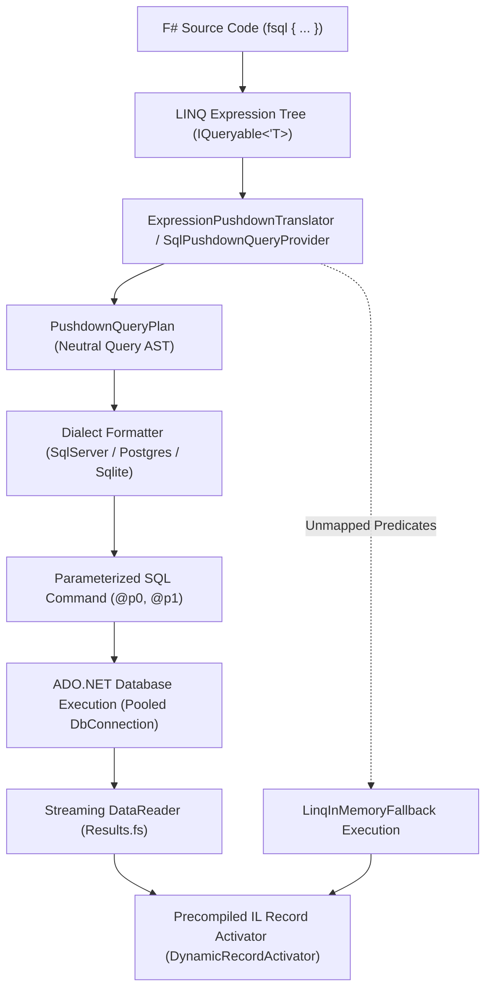

# FSQL Language Specification

> **Document Type**: Internal Technical Language Specification  
> **Specification Version**: 1.2  
> **Status**: Canonical  
> **Applies to**: F# Query Studio Universal Query Engine  
> **Target Dialects**: SQL Server (T-SQL), PostgreSQL, SQLite  

---

## Table of Contents
1. [Overview & Architecture](#1-overview--architecture)
   - 1.1 [Definition](#11-definition)
   - 1.2 [Core Design Principles](#12-core-design-principles)
   - 1.3 [Compilation Pipeline](#13-compilation-pipeline)
   - 1.4 [Execution & Streaming Architecture](#14-execution--streaming-architecture)
2. [Formal Grammar (EBNF)](#2-formal-grammar-ebnf)
3. [Query Sources & Data Binding](#3-query-sources--data-binding)
   - 3.1 [Primary Table Iteration (`Connections.sql`)](#31-primary-table-iteration-connectionssql)
   - 3.2 [Subquery Sources (Derived Tables)](#32-subquery-sources-derived-tables)
4. [Filtering & Predicate Expressions](#4-filtering--predicate-expressions)
   - 4.1 [Scalar Filters & Boolean Logic (`where`)](#41-scalar-filters--boolean-logic-where)
   - 4.2 [String Predicates & Pattern Matching](#42-string-predicates--pattern-matching)
   - 4.3 [Range Comparisons](#43-range-comparisons)
   - 4.4 [Null Checks & F# Option / Nullable Types](#44-null-checks--f-option--nullable-types)
   - 4.5 [In-List Membership (`Contains`)](#45-in-list-membership-contains)
   - 4.6 [Boolean Dialect Representation](#46-boolean-dialect-representation)
5. [Correlated Subqueries & DQL Extensions](#5-correlated-subqueries--dql-extensions)
   - 5.1 [Existence Subqueries (`whereExists`)](#51-existence-subqueries-whereexists)
   - 5.2 [Non-Existence Subqueries (`whereNotExists`)](#52-non-existence-subqueries-wherenotexists)
   - 5.3 [Set Membership Subqueries (`IN` Subquery)](#53-set-membership-subqueries-in-subquery)
6. [Relational Joins & Lateral Apply](#6-relational-joins--lateral-apply)
   - 6.1 [Inner Join (`join ... on ...`)](#61-inner-join-join--on-)
   - 6.2 [Left Outer Join (`leftOuterJoin`)](#62-left-outer-join-leftouterjoin)
   - 6.3 [Composite Key Joins](#63-composite-key-joins)
   - 6.4 [Correlated Row-Level Joins (`crossApply` and `lateral`)](#64-correlated-row-level-joins-crossapply-and-lateral)
   - 6.5 [Cross Joins & Outer Apply](#65-cross-joins--outer-apply)
7. [Grouping, Aggregation & HAVING](#7-grouping-aggregation--having)
   - 7.1 [Grouping (`groupBy`)](#71-grouping-groupby)
   - 7.2 [Aggregate Filtering (`having`)](#72-aggregate-filtering-having)
   - 7.3 [Column-Level and Distinct Counts](#73-column-level-and-distinct-counts)
   - 7.4 [Safe Aggregate Ordering (SQL Server T-SQL 412 Mitigation)](#74-safe-aggregate-ordering-sql-server-t-sql-412-mitigation)
8. [Projections & Result Shaping (`select`)](#8-projections--result-shaping-select)
   - 8.1 [Anonymous Records and Tuples](#81-anonymous-records-and-tuples)
   - 8.2 [Built-In String Functions](#82-built-in-string-functions)
   - 8.3 [DateTime & DateOnly Extraction & Formatting](#83-datetime--dateonly-extraction--formatting)
   - 8.4 [Math Functions](#84-math-functions)
   - 8.5 [Conditional Expressions (`if ... then ... else`)](#85-conditional-expressions-if--then--else)
   - 8.6 [Correlated Scalar Subqueries in SELECT](#86-correlated-scalar-subqueries-in-select)
9. [Ordering, Pagination & Set Modifiers](#9-ordering-pagination--set-modifiers)
   - 9.1 [Sorting (`sortBy`, `thenBy`)](#91-sorting-sortby-thenby)
   - 9.2 [Deduplication (`distinct`)](#92-deduplication-distinct)
   - 9.3 [Pagination (`take`, `skip`)](#93-pagination-take-skip)
   - 9.4 [Terminal Scalar Evaluation](#94-terminal-scalar-evaluation)
10. [Fluent Pushdown API (`SqlPushdownQueryable<'T>`)](#10-fluent-pushdown-api-sqlpushdownqueryablet)
   - 10.1 [Filter & Pagination Extensions](#101-filter--pagination-extensions)
   - 10.2 [Grouping & Having Extensions](#102-grouping--having-extensions)
   - 10.3 [Apply & Join Extensions](#103-apply--join-extensions)
   - 10.4 [Direct Aggregate Execution](#104-direct-aggregate-execution)
11. [Hybrid Execution & In-Memory Fallback (`LinqInMemoryFallback`)](#11-hybrid-execution--in-memory-fallback-linqinmemoryfallback)
12. [Comprehensive Multi-Dialect Pushdown Matrix](#12-comprehensive-multi-dialect-pushdown-matrix)
13. [Diagnostic & Tooling APIs](#13-diagnostic--tooling-apis)
   - 13.1 [`toRawQuery` (Formatted SQL Inspection)](#131-torawquery-formatted-sql-inspection)
   - 13.2 [`toRawSql` (Unformatted Raw SQL)](#132-torawsql-unformatted-raw-sql)
   - 13.3 [`toRawSqlWithParameters` (Tuple Extraction)](#133-torawsqlwithparameters-tuple-extraction)
   - 13.4 [Plan-Level Diagnostic APIs](#134-plan-level-diagnostic-apis)
14. [Conformance Rules for Developers and AI Agents](#14-conformance-rules-for-developers-and-ai-agents)

---

## 1. Overview & Architecture

### 1.1 Definition
**FSQL** (F# Structured Query Language) is a declarative, strongly-typed domain-specific language (DSL) embedded natively in F# through the `fsql { ... }` computation expression and `SqlPushdownQueryable<'T>` LINQ provider. FSQL serves as the canonical Data Query Language (DQL) for F# Query Studio, compiling functional query expressions directly into optimized, native SQL statements executed on the target database engine (Universal SQL Pushdown).

### 1.2 Core Design Principles
1. **Compile-Time Type Safety**: Queries are verified by the F# compiler and language service against database schema metadata. Column typos, invalid joins, and type mismatches fail at compile time.
2. **Universal SQL Pushdown**: Filters (`where`), existence checks (`whereExists`), joins (`join`, `leftOuterJoin`), groupings (`groupBy`), aggregate filters (`having`), sorting (`sortBy`), projections (`select`), and pagination (`take`, `skip`) are pushed down to the database engine. Only requested columns and filtered rows traverse the network.
3. **Strict Parameterization**: Literals and closure variables in query predicates are automatically extracted and bound as typed parameters (`@p0`, `@p1`), preventing SQL injection attacks entirely.
4. **Dialect Independence**: The same FSQL code compiles to dialect-specific SQL for SQL Server (T-SQL), PostgreSQL, and SQLite without requiring user-side query modifications.
5. **Hybrid Fallback Execution**: When queries contain arbitrary F# functions or unmapped predicates, FSQL pushes down all compatible SQL clauses (WHERE, JOIN, ORDER BY, GROUP BY) to the database and transparently evaluates remaining logic in process memory via `LinqInMemoryFallback`.

### 1.3 Compilation Pipeline



### 1.4 Execution & Streaming Architecture
- **ADO.NET Connection Pooling**: Reuses underlying pooled connections, minimizing handshake overhead.
- **Lazy Cursor Streaming**: Reads query rows incrementally through an unbuffered `IDataReader` cursor into results envelopes without loading entire datasets into memory.
- **Precompiled IL Record Activation**: Instantiates target F# records and anonymous records using dynamic IL generation (`DynamicRecordActivator`), eliminating reflection overhead.

---

## 2. Formal Grammar (EBNF)

The formal grammar of the `fsql { ... }` computation expression extends `Microsoft.FSharp.Linq.QueryBuilder`:

```ebnf
FSqlExpression ::=
    "fsql" "{"
        SourceClause
        { JoinClause }
        { FilterClause }
        [ GroupByClause ]
        [ HavingClause ]
        [ OrderByClause ]
        [ PagingClause ]
        ProjectionClause
    "}"
    | "fsql" "{"
        SourceClause
        TerminalAggregateClause
      "}" ;

SourceClause ::=
    "for" Identifier "in" QuerySource "do" ;

QuerySource ::=
    QualifiedIdentifier
    | "(" FSqlExpression ")"
    | "(" "crossApply" "(" FSqlExpression ")" ")"
    | "(" "lateral" "(" FSqlExpression ")" ")" ;

JoinClause ::=
    "join" Identifier "in" QuerySource "on" "(" KeyExpression "=" KeyExpression ")"
    | "leftOuterJoin" Identifier "in" QuerySource "on" "(" KeyExpression "=" KeyExpression ")" "into" Identifier
      "for" Identifier "in" Identifier ".DefaultIfEmpty()" "do"
    | "for" Identifier "in" "(" "crossApply" "(" FSqlExpression ")" ")" "do"
    | "for" Identifier "in" "(" "lateral" "(" FSqlExpression ")" ")" "do"
    | "for" Identifier "in" "(" FSqlExpression ")" "do" ;

FilterClause ::=
    "where" "(" BooleanExpression ")"
    | "whereExists" "(" FSqlExpression ")"
    | "whereNotExists" "(" FSqlExpression ")" ;

GroupByClause ::=
    "groupBy" Expression "into" Identifier ;

HavingClause ::=
    "having" "(" BooleanExpression ")" ;

OrderByClause ::=
    ( "sortBy" | "sortByDescending" ) Expression
    { ( "thenBy" | "thenByDescending" ) Expression } ;

PagingClause ::=
    [ "distinct" ]
    [ "skip" IntegerExpression ]
    [ "take" IntegerExpression ] ;

ProjectionClause ::=
    "select" ( AnonymousRecord | Tuple | Identifier | ScalarExpression ) ;

TerminalAggregateClause ::=
    "count"
    | "sumBy" NumericExpression
    | "minBy" ComparableExpression
    | "maxBy" ComparableExpression
    | "averageBy" NumericExpression
    | "head"
    | "nth" IntegerExpression ;
```

---

## 3. Query Sources & Data Binding

### 3.1 Primary Table Iteration (`Connections.sql`)
Queries begin with a `for ... in ... do` clause binding a typed collection from `Connections.sql`:
```fsharp
fsql {
    for c in Connections.sql.SampleStore.Customers do
    select c
}
```
- **Generated SQL:** `SELECT _t0.* FROM Customers _t0`
- **Aliasing:** The base source is assigned the table alias `_t0`.

### 3.2 Subquery Sources (Derived Tables)
An `fsql` expression can iterate over an inner `fsql` expression:
```fsharp
fsql {
    for highValueOrder in (
        fsql {
            for o in Connections.sql.SampleStore.Orders do
            where (o.TotalAmount >= 500.0f)
            select o
        }
    ) do
    select highValueOrder.Id
}
```
- **Generated SQL:** `SELECT _t0.Id FROM (SELECT _sub0.* FROM Orders _sub0 WHERE (_sub0.TotalAmount >= @p0)) _t0`

---

## 4. Filtering & Predicate Expressions

### 4.1 Scalar Filters & Boolean Logic (`where`)
Filters rows using boolean expressions:
```fsharp
fsql {
    for c in Connections.sql.SampleStore.Customers do
    where (c.Country = "Brazil" && c.Age >= 21)
    select c
}
```
- **Operator Translation:**
  - `=` translates to `=`
  - `<>` translates to `<>`
  - `&&` translates to `AND`
  - `||` translates to `OR`
  - `not` translates to `NOT`
  - `<`, `<=`, `>`, `>=` translate directly
- **Parameter Extraction:** Literal `"Brazil"` becomes `@p0`, and `21` becomes `@p1`.

### 4.2 String Predicates & Pattern Matching
F# string methods are translated to SQL `LIKE` expressions:
```fsharp
where (c.Email.EndsWith("@example.com") && c.FirstName.StartsWith("A") && c.Company.Contains("Tech"))
```
- **Generated SQL:** `WHERE (_t0.Email LIKE @p0 AND _t0.FirstName LIKE @p1 AND _t0.Company LIKE @p2)`
- Parameter values are automatically wrapped with SQL wildcards:
  - `@p0 = '%@example.com'`
  - `@p1 = 'A%'`
  - `@p2 = '%Tech%'`

### 4.3 Range Comparisons
```fsharp
where (c.Age >= 18 && c.Age <= 65)
```
- **Generated SQL:** `WHERE (_t0.Age >= @p0 AND _t0.Age <= @p1)`

### 4.4 Null Checks & F# Option / Nullable Types
FSQL provides complete, transparent handling of `option<'T>`, `voption<'T>`, and `Nullable<'T>`:
```fsharp
// Explicit null check
where (not (isNull c.Company))

// Option property checks
where c.Description.IsSome
where c.Description.IsNone

// Automatic .Value unwrapping (maps directly to the column, avoiding nonexistent 'Value' column references)
where (c.Description.Value = "HighQuality")
```
- **Generated SQL:**
  - `not (isNull c.Company)` -> `WHERE (_t0.Company IS NOT NULL)`
  - `c.Description.IsSome` -> `WHERE (_t0.Description IS NOT NULL)`
  - `c.Description.IsNone` -> `WHERE (_t0.Description IS NULL)`
  - `c.Description.Value = "HighQuality"` -> `WHERE (_t0.Description = @p0)`

### 4.5 In-List Membership (`Contains`)
```fsharp
// 1. Parameterized IN with local F# collections
let targetCategories = [ "Electronics"; "Hardware" ]
fsql {
    for p in Connections.sql.SampleStore.Products do
    where (targetCategories.Contains(p.Category))
    select p.Name
}
// Generated SQL: WHERE _t0.Category IN (@p0, @p1)

// Note: If targetCategories is empty, FSQL emits `1 = 0` to safely short-circuit without syntax errors.
```

### 4.6 Boolean Dialect Representation
Boolean expressions are automatically translated into target database representations:
- **PostgreSQL:** Emits `TRUE` and `FALSE` literals.
- **SQL Server:** Emits `1` and `0` (`BIT` type).
- **SQLite:** Emits `1` and `0` (`INTEGER` type).

---

## 5. Correlated Subqueries & DQL Extensions

### 5.1 Existence Subqueries (`whereExists`)
FSQL provides first-class custom operations for `EXISTS` checks:
```fsharp
fsql {
    for c in Connections.sql.SampleStore.Customers do
    whereExists (
        fsql {
            for o in Connections.sql.SampleStore.Orders do
            where (o.CustomerId = c.Id && o.TotalAmount >= 250.0f)
        }
    )
    select c.FirstName
}
```
- **Generated SQL:**
  ```sql
  SELECT _t0.FirstName AS FirstName
  FROM Customers _t0
  WHERE EXISTS (
    SELECT 1
    FROM Orders _sub1
    WHERE (_sub1.CustomerId = _t0.Id AND _sub1.TotalAmount >= @p0)
  )
  ```
- **Optimization:** The compiler rewrites the inner subquery projection to `SELECT 1` automatically.

### 5.2 Non-Existence Subqueries (`whereNotExists`)
```fsharp
fsql {
    for c in Connections.sql.SampleStore.Customers do
    whereNotExists (
        fsql {
            for o in Connections.sql.SampleStore.Orders do
            where (o.CustomerId = c.Id)
        }
    )
    select c.FirstName
}
```
- **Generated SQL:**
  ```sql
  SELECT _t0.FirstName AS FirstName
  FROM Customers _t0
  WHERE NOT EXISTS (
    SELECT 1
    FROM Orders _sub1
    WHERE (_sub1.CustomerId = _t0.Id)
  )
  ```

### 5.3 Set Membership Subqueries (`IN` Subquery)
Subquery containment compiles to `IN (SELECT ...)`:
```fsharp
fsql {
    for p in Connections.sql.SampleStore.Products do
    where ((fsql { for o in Connections.sql.SampleStore.Orders do where (o.Quantity >= 5); select o.ProductId }).Contains(p.Id))
    select p.Name
}
```
- **Generated SQL:**
  ```sql
  SELECT _t0.Name AS Name
  FROM Products _t0
  WHERE (_t0.Id IN (
    SELECT _sub1.ProductId AS ProductId
    FROM Orders _sub1
    WHERE (_sub1.Quantity >= @p0)
  ))
  ```

---

## 6. Relational Joins & Lateral Apply

### 6.1 Inner Join (`join ... on ...`)
```fsharp
fsql {
    for o in Connections.sql.SampleStore.Orders do
    join c in Connections.sql.SampleStore.Customers on (o.CustomerId = c.Id)
    select {| OrderId = o.Id; Customer = c.FirstName + " " + c.LastName |}
}
```
- **Generated SQL:** `FROM Orders _t0 INNER JOIN Customers _t1 ON (_t0.CustomerId = _t1.Id)`

### 6.2 Left Outer Join (`leftOuterJoin`)
```fsharp
fsql {
    for c in Connections.sql.SampleStore.Customers do
    leftOuterJoin o in Connections.sql.SampleStore.Orders on (c.Id = o.CustomerId) into g
    for o in g.DefaultIfEmpty() do
    select {|
        CustomerId = c.Id
        OrderId = (if isNull (box o) then 0 else o.Id)
    |}
}
```
- **Generated SQL:** `FROM Customers _t0 LEFT OUTER JOIN Orders _t1 ON (_t0.Id = _t1.CustomerId)`

### 6.3 Composite Key Joins
Tuple equality expresses multi-column join criteria:
```fsharp
join t in Connections.excel.Targets.Sheet1 on ((s.StoreId, s.Region) = (t.StoreId, t.Region))
```
- **Generated SQL:** `ON (_t0.StoreId = _t1.StoreId AND _t0.Region = _t1.Region)`

### 6.4 Correlated Row-Level Joins (`crossApply` and `lateral`)
Correlates each outer row with a parameterized subquery (e.g., retrieving the latest order per customer):
```fsharp
fsql {
    for c in Connections.sql.SampleStore.Customers do
    for o in (
        crossApply (
            fsql {
                for o in Connections.sql.SampleStore.Orders do
                where (o.CustomerId = c.Id)
                sortByDescending o.OrderDate
                take 1
                select o
            }
        )
    ) do
    select {| Customer = c.FirstName; LatestOrderId = o.Id |}
}
```
- **SQL Server:** Emits `CROSS APPLY (SELECT TOP (1) ... WHERE _sub1.CustomerId = _t0.Id ...)`
- **PostgreSQL:** Emits `CROSS JOIN LATERAL (SELECT ... WHERE _sub1.CustomerId = _t0.Id ... LIMIT 1)`
- **SQLite:** Emits `CROSS JOIN (SELECT ... WHERE _sub1.CustomerId = _t0.Id ... LIMIT 1)` with transparent correlated evaluation.
- **Idiomatic PostgreSQL Alias:** `lateral` is fully supported as an identical synonym to `crossApply`.

### 6.5 Cross Joins & Outer Apply
Using fluent extensions or subquery joins:
- **`CrossJoin`:** Emits `CROSS JOIN Table alias` without an `ON` clause across all engines.
- **`OuterApply`:**
  - SQL Server: `OUTER APPLY (subquery) AS alias`
  - PostgreSQL: `LEFT JOIN LATERAL (subquery) AS alias ON true`
  - SQLite: `LEFT JOIN (subquery) AS alias ON 1=1`

---

## 7. Grouping, Aggregation & HAVING

### 7.1 Grouping (`groupBy`)
```fsharp
fsql {
    for o in Connections.sql.SampleStore.Orders do
    groupBy o.CustomerId into g
    select {|
        CustomerId = g.Key
        TotalOrders = fsql { for item in g do count }
    |}
}
```
- **Generated SQL:** `SELECT _t0.CustomerId AS CustomerId, COUNT(*) AS TotalOrders FROM Orders _t0 GROUP BY _t0.CustomerId`

### 7.2 Aggregate Filtering (`having`)
The dedicated `having` custom operation filters grouped aggregations:
```fsharp
fsql {
    for o in Connections.sql.SampleStore.Orders do
    groupBy o.CustomerId into g
    having (fsql { for item in g do count } >= 10)
    select {|
        CustomerId = g.Key
        TotalOrders = fsql { for item in g do count }
    |}
}
```
- **Generated SQL:**
  ```sql
  SELECT _t0.CustomerId AS CustomerId, COUNT(*) AS TotalOrders
  FROM Orders _t0
  GROUP BY _t0.CustomerId
  HAVING (COUNT(*) >= @p0)
  ```

### 7.3 Column-Level and Distinct Counts
- **Column-level count pushdown:**
  ```fsharp
  fsql { for p in products do select p.Id; count }
  ```
  Generates `SELECT COUNT(_t0.Id) FROM Products _t0`.
- **Fluent API Aggregates:**
  - `query.Count()` -> `SELECT COUNT(*) FROM ...`
  - `query.Count("Email")` -> `SELECT COUNT(_t0.Email) FROM ...`
  - `query.CountDistinct("Country")` -> `SELECT COUNT(DISTINCT _t0.Country) FROM ...`
  - `query.Sum("TotalAmount")` -> `SELECT SUM(_t0.TotalAmount) FROM ...`
  - `query.Min("TotalAmount")` -> `SELECT MIN(_t0.TotalAmount) FROM ...`
  - `query.Max("TotalAmount")` -> `SELECT MAX(_t0.TotalAmount) FROM ...`
  - `query.Average("TotalAmount")` -> `SELECT AVG(_t0.TotalAmount) FROM ...`

### 7.4 Safe Aggregate Ordering (SQL Server T-SQL 412 Mitigation)
In SQL Server, queries combining scalar aggregations without `GROUP BY` and an `ORDER BY` clause cause runtime error 412:
> *The ORDER BY clause is invalid in views, inline functions, derived tables, subqueries, and common table expressions, unless TOP, OFFSET or FOR XML is also specified.*

FSQL inspects the plan and automatically elides the redundant `ORDER BY` clause when compiling single-row scalar aggregate queries on SQL Server, ensuring complete compatibility.

---

## 8. Projections & Result Shaping (`select`)

### 8.1 Anonymous Records and Tuples
```fsharp
select {|
    Id = c.Id
    FullName = c.FirstName + " " + c.LastName
    City = c.City
|}
```
- **Generated SQL:** `SELECT _t0.Id AS Id, (_t0.FirstName || ' ' || _t0.LastName) AS FullName, _t0.City AS City` (SQL Server uses `+`).

### 8.2 Built-In String Functions
- **Concatenation:** `c.FirstName + " " + c.LastName` or `String.Concat(...)`
- **Case conversion:** `c.Name.ToUpper()` -> `UPPER(_t0.Name)`, `c.Name.ToLower()` -> `LOWER(_t0.Name)`
- **Trimming:** `c.Name.Trim()` -> `TRIM(_t0.Name)`
- **Substring:**
  - `c.Name.Substring(0, 5)` -> SQL Server: `SUBSTRING(_t0.Name, 1, 5)`, Postgres/SQLite: `SUBSTR(_t0.Name, 1, 5)` (0-to-1 index adjustment handled automatically).
- **Replacement:** `c.Email.Replace("@old.com", "@new.com")` -> `REPLACE(_t0.Email, @p0, @p1)`

### 8.3 DateTime & DateOnly Extraction & Formatting
FSQL translates .NET date and time properties and methods into engine-specific expressions:
- **Component Extraction:**
  - `e.EventDate.Year` -> SQLite: `CAST(strftime('%Y', _t0.EventDate) AS INTEGER)`, SQL Server: `YEAR(_t0.EventDate)`, PostgreSQL: `EXTRACT(YEAR FROM _t0.EventDate)`
  - `e.EventDate.Month` -> SQLite: `CAST(strftime('%m', _t0.EventDate) AS INTEGER)`, SQL Server: `MONTH(_t0.EventDate)`, PostgreSQL: `EXTRACT(MONTH FROM _t0.EventDate)`
  - `e.EventDate.Day` -> SQLite: `CAST(strftime('%d', _t0.EventDate) AS INTEGER)`, SQL Server: `DAY(_t0.EventDate)`, PostgreSQL: `EXTRACT(DAY FROM _t0.EventDate)`
  - `e.EventDate.Date` -> SQLite: `date(_t0.EventDate)`, SQL Server/PostgreSQL: `CAST(_t0.EventDate AS DATE)`
  - `e.EventDate.Hour` -> SQLite: `CAST(strftime('%H', ...) AS INTEGER)`, SQL Server: `DATEPART(HOUR, ...)`, PostgreSQL: `EXTRACT(HOUR FROM ...)`
  - `e.EventDate.Minute` -> SQLite: `CAST(strftime('%M', ...) AS INTEGER)`, SQL Server: `DATEPART(MINUTE, ...)`, PostgreSQL: `EXTRACT(MINUTE FROM ...)`
  - `e.EventDate.Second` -> SQLite: `CAST(strftime('%S', ...) AS INTEGER)`, SQL Server: `DATEPART(SECOND, ...)`, PostgreSQL: `EXTRACT(SECOND FROM ...)`
- **Date Formatting (`.ToString(...)`):**
  - `e.EventDate.ToString("yyyy-MM-dd")`:
    - SQLite: `strftime('%Y-%m-%d', _t0.EventDate)`
    - SQL Server: `FORMAT(_t0.EventDate, 'yyyy-MM-dd')`
    - PostgreSQL: `to_char(_t0.EventDate, 'YYYY-MM-DD')`
  - `e.Price.ToString()`:
    - SQLite / PostgreSQL: `CAST(_t0.Price AS TEXT)`
    - SQL Server: `CAST(_t0.Price AS NVARCHAR(MAX))`

### 8.4 Math Functions
- `Math.Round(p.Price, 2)` -> `ROUND(_t0.Price, 2)`
- `Math.Abs(p.Delta)` -> `ABS(_t0.Delta)`

### 8.5 Conditional Expressions (`if ... then ... else`)
```fsharp
select {|
    Status = if c.InStock <> 0 then "Available" else "Out of Stock"
|}
```
- **Generated SQL:** `SELECT (CASE WHEN (_t0.InStock <> 0) THEN 'Available' ELSE 'Out of Stock' END) AS Status`

### 8.6 Correlated Scalar Subqueries in SELECT
Subqueries can be embedded directly within `select` properties to compute per-row values:
```fsharp
select {|
    CustomerName = c.FirstName + " " + c.LastName
    OrderCount = fsql { for o in Connections.sql.SampleStore.Orders do where (o.CustomerId = c.Id); count }
|}
```
- **Generated SQL:**
  ```sql
  SELECT
    (_t0.FirstName || ' ' || _t0.LastName) AS CustomerName,
    (SELECT COUNT(*) FROM Orders _sub1 WHERE (_sub1.CustomerId = _t0.Id)) AS OrderCount
  FROM Customers _t0
  ```

---

## 9. Ordering, Pagination & Set Modifiers

### 9.1 Sorting (`sortBy`, `thenBy`)
```fsharp
sortBy c.Country
thenByDescending c.City
```
- **Generated SQL:** `ORDER BY _t0.Country ASC, _t0.City DESC`

### 9.2 Deduplication (`distinct`)
```fsharp
distinct
select c.Country
```
- **Generated SQL:** `SELECT DISTINCT _t0.Country FROM Customers _t0`

### 9.3 Pagination (`take`, `skip`)
```fsharp
sortBy c.Id
skip 20
take 10
```
- **PostgreSQL / SQLite:** `LIMIT 10 OFFSET 20`
- **SQL Server (Take + Skip):** `OFFSET 20 ROWS FETCH NEXT 10 ROWS ONLY`
- **SQL Server (Take without Skip):**
  - If ordered: `OFFSET 0 ROWS FETCH NEXT 10 ROWS ONLY`
  - If unordered: `SELECT TOP (10) ...`
- **SQL Server (Skip without Take):** `OFFSET 20 ROWS`

### 9.4 Terminal Scalar Evaluation
Terminal operations execute immediately on the database connection:
```fsharp
let totalCustomers = fsql { for c in db.Customers do count }
let maxOrderAmount = fsql { for o in db.Orders do maxBy o.TotalAmount }
let minOrderAmount = fsql { for o in db.Orders do minBy o.TotalAmount }
let sumOrderAmount = fsql { for o in db.Orders do sumBy o.TotalAmount }
let avgOrderAmount = fsql { for o in db.Orders do averageBy o.TotalAmount }
```

---

## 10. Fluent Pushdown API (`SqlPushdownQueryable<'T>`)

In addition to the `fsql { ... }` computation expression, `SqlPushdownQueryable<'T>` exposes a composable, chainable API:

### 10.1 Filter & Pagination Extensions
```fsharp
let paged =
    queryable
        .Where("Price > @minPrice", [ "@minPrice", box 25.0M ])
        .WhereIn("Category", [ "Electronics"; "Hardware" ])
        .Page(page = 1, pageSize = 20)
```

### 10.2 Grouping & Having Extensions
```fsharp
let highVolume =
    queryable
        .GroupBy("Category")
        .SelectProjection("Category, COUNT(*) AS TotalCount")
        .Having("COUNT(*) >= @threshold", [ "@threshold", box 5 ])
```

### 10.3 Apply & Join Extensions
```fsharp
let withDetails =
    queryable
        .CrossApply("SELECT TOP (1) * FROM Orders o WHERE o.ProductId = _t0.Id", "_o")
        .OuterApply("SELECT COUNT(*) AS Cnt FROM Reviews r WHERE r.ProductId = _t0.Id", "_r")
        .CrossJoin("Categories", "_c")
```

### 10.4 Direct Aggregate Execution
```fsharp
let total = queryable.Count()
let uniqueCats = queryable.CountDistinct("Category")
let maxPrice = queryable.Max<decimal>("Price")
let avgPrice = queryable.Average<decimal>("Price")
```

---

## 11. Hybrid Execution & In-Memory Fallback (`LinqInMemoryFallback`)

When an FSQL query contains arbitrary F# functions or unmapped operations that cannot be translated into SQL, FSQL does not abort or fail:
1. **Pushdown Partitioning**: All compatible predicates (`WHERE`), joins, groupings, and orderings are pushed down and executed natively by the database engine.
2. **Streaming Materialization**: Matched rows are retrieved from the database cursor.
3. **In-Memory Dynamic Evaluation**: Unmapped F# predicates are compiled to delegates (`LinqInMemoryFallback.evaluate`) and evaluated in process memory, preserving expected F# semantics transparently.

---

## 12. Comprehensive Multi-Dialect Pushdown Matrix

The FSQL compiler translates the neutral `PushdownQueryPlan` into engine-specific SQL:

| DQL Feature | SQL Server (T-SQL) | PostgreSQL | SQLite |
|---|---|---|---|
| **Identifier Quoting** | `[Column]` | `"Column"` | `[Column]` or `"Column"` |
| **Parameter Syntax** | `@p0`, `@p1` | `@p0`, `@p1` | `@p0`, `@p1` |
| **Pagination (Take + Skip)** | `OFFSET m ROWS FETCH NEXT n ROWS ONLY` | `LIMIT n OFFSET m` | `LIMIT n OFFSET m` |
| **Top without Offset** | `SELECT TOP (n) ...` | `SELECT ... LIMIT n` | `SELECT ... LIMIT n` |
| **String Concatenation** | `+` | `||` | `||` |
| **Correlated Apply** | `CROSS APPLY (...)` | `CROSS JOIN LATERAL (...)` | `CROSS JOIN (...)` |
| **Outer Apply** | `OUTER APPLY (...)` | `LEFT JOIN LATERAL (...) ON true` | `LEFT JOIN (...) ON 1=1` |
| **Cross Join** | `CROSS JOIN Table alias` | `CROSS JOIN Table alias` | `CROSS JOIN Table alias` |
| **Boolean Values** | `1` / `0` (`BIT`) | `TRUE` / `FALSE` (`BOOLEAN`) | `1` / `0` (`INTEGER`) |
| **Option / Nullable Unwrapping** | Strips `.Value`, maps to column | Strips `.Value`, maps to column | Strips `.Value`, maps to column |
| **Option IsSome / IsNone** | `IS NOT NULL` / `IS NULL` | `IS NOT NULL` / `IS NULL` | `IS NOT NULL` / `IS NULL` |
| **Substring** | `SUBSTRING(col, start + 1, len)` | `SUBSTR(col, start + 1, len)` | `SUBSTR(col, start + 1, len)` |
| **Date Year / Month / Day** | `YEAR(c)`, `MONTH(c)`, `DAY(c)` | `EXTRACT(YEAR FROM c)`, etc. | `CAST(strftime('%Y', c) AS INTEGER)` |
| **Date Casting** | `CAST(c AS DATE)` | `CAST(c AS DATE)` | `date(c)` |
| **Date Formatting** | `FORMAT(c, 'yyyy-MM-dd')` | `to_char(c, 'YYYY-MM-DD')` | `strftime('%Y-%m-%d', c)` |
| **Text Casting** | `CAST(c AS NVARCHAR(MAX))` | `CAST(c AS TEXT)` | `CAST(c AS TEXT)` |
| **Math Round / Abs** | `ROUND(c, digits)`, `ABS(c)` | `ROUND(c, digits)`, `ABS(c)` | `ROUND(c, digits)`, `ABS(c)` |
| **Column-Specific Count** | `COUNT([col])` | `COUNT("col")` | `COUNT([col])` |
| **Distinct Count** | `COUNT(DISTINCT [col])` | `COUNT(DISTINCT "col")` | `COUNT(DISTINCT [col])` |
| **Aggregate ORDER BY Rule** | Elided when no `GROUP BY` is present | Elided when no `GROUP BY` is present | Elided when no `GROUP BY` is present |

---

## 13. Diagnostic & Tooling APIs

### 13.1 `toRawQuery` (Formatted SQL Inspection)
Inspects the compiled SQL with formatted indentation, clause line breaks, and documented bound parameters in a header comment:
```fsharp
let query =
    fsql {
        for c in Connections.sql.SampleStore.Customers do
        where (c.Country = "USA")
        whereExists (fsql { for o in Connections.sql.SampleStore.Orders do where (o.CustomerId = c.Id && o.TotalAmount >= 100.0f) })
        select {| Customer = c.FirstName + " " + c.LastName |}
    }

printfn "%s" (toRawQuery query)
```

**Formatted Output:**
```sql
-- Parameters:
--   @p0 = 'USA'
--   @p1 = 100

SELECT
  (_t0.FirstName || ' ' || _t0.LastName) AS Customer
FROM Customers _t0
WHERE (_t0.Country = @p0
  AND EXISTS (
    SELECT 1
    FROM Orders _sub1
    WHERE (_sub1.CustomerId = _t0.Id AND _sub1.TotalAmount >= @p1)
  ))
```

### 13.2 `toRawSql` (Unformatted Raw SQL)
Extracts the raw SQL string with bound parameters header:
```fsharp
let rawSql = toRawSql query
// Returns: "-- Parameters:\n--   @p0 = 'USA'...\nSELECT ..."
```

### 13.3 `toRawSqlWithParameters` (Tuple Extraction)
Extracts the unformatted SQL string and list of parameter key-value tuples for automated assertions and low-level interop:
```fsharp
let sql, parameters = toRawSqlWithParameters query
// sql: string
// parameters: (string * obj) list
```

### 13.4 Plan-Level Diagnostic APIs
On `PushdownQueryPlan`:
- `plan.ToRawQuery(?dialect: SqlDialect) : string`
- `plan.BuildRawSql(dialect: SqlDialect) : string`
- `plan.BuildRawQuery(dialect: SqlDialect) : string`
- `plan.BuildSql(dialect: SqlDialect) : string`

---

## 14. Conformance Rules for Developers and AI Agents

1. **Exclusivity of `fsql`**: Always use `fsql { ... }`. Never use standard LINQ `query { ... }` or legacy `fquery`.
2. **Zero Raw SQL String Concatenation**: Write 100% pure F# DSL. Do not interpolate SQL strings (`$"SELECT ..."`).
3. **Immutability of Plans**: Transforming a `PushdownQueryPlan` must always yield a new independent instance via `.Clone()`.
4. **Anonymous Records for Projections**: Projections with multiple fields should use anonymous records `{| Field = value |}` for strong typing and zero boilerplate.
5. **Reference Guide**: AI coding agents generating queries must consult [`docs/FSQL_AI_AGENT_GUIDE.md`](FSQL_AI_AGENT_GUIDE.md) for full usage instructions and guardrails.
