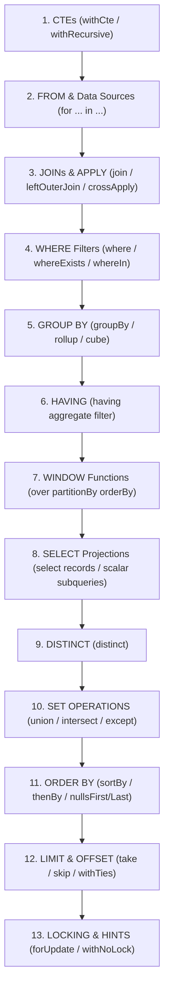
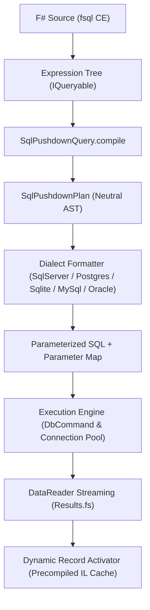

# FSQL Language Specification
## Universal Data Query Language (DQL) & Multi-Dialect SQL Compilation Specification

**Version:** 1.0  
**Status:** Canonical / Active  
**Scope:** Relational Database Engines (SQL Server, PostgreSQL, SQLite, MySQL, MariaDB, Oracle) and Staged Analytical Engines  
**Date:** November 2026  

---

## Table of Contents
1. [Overview & Design Principles](#1-overview--design-principles)
2. [Formal Grammar (EBNF)](#2-formal-grammar-ebnf)
3. [Logical Query Processing Pipeline](#3-logical-query-processing-pipeline)
4. [Query Structure & Common Table Expressions (CTEs)](#4-query-structure--common-table-expressions-ctes)
5. [Relational & Correlated Joins](#5-relational--correlated-joins)
6. [Row Selection & Predicates](#6-row-selection--predicates)
7. [Grouping & Aggregate Computations](#7-grouping--aggregate-computations)
8. [Window & Analytical Functions (OLAP)](#8-window--analytical-functions-olap)
9. [Projections & Result Shaping](#9-projections--result-shaping)
10. [Compound Set Operations](#10-compound-set-operations)
11. [Sorting, Slicing & Concurrency Modifiers](#11-sorting-slicing--concurrency-modifiers)
12. [Universal Multi-Dialect Compilation Matrix](#12-universal-multi-dialect-compilation-matrix)
13. [Compiler Architecture & Execution Pipeline](#13-compiler-architecture--execution-pipeline)
14. [Inspection & Tooling APIs](#14-inspection--tooling-apis)
15. [Conformance & Agent Guidelines](#15-conformance--agent-guidelines)

---

## 1. Overview & Design Principles

### 1.1 Definition
**FSQL** (F# Structured Query Language) is a declarative, strongly-typed domain-specific language (DSL) embedded natively in F# through *Computation Expressions* (`fsql { ... }`) and LINQ Expression Trees / Quotations. FSQL provides a unified, dialect-agnostic Data Query Language (DQL) specification designed to compile high-level functional queries directly into optimized, native SQL statements (Universal SQL Pushdown), guaranteeing compile-time type safety, automated parameterization, and zero-allocation streaming execution.

### 1.2 Core Design Principles
1. **Compile-Time Type Safety & IntelliSense**: Every FSQL query is validated at compile/typecheck time against database schema metadata, eliminating common runtime errors such as misspelled column names, invalid joins, or type mismatches.
2. **Universal SQL Pushdown**: All filtering, projection, joining, ordering, grouping, aggregation, windowing, and pagination operations are pushed down to the underlying database engine. Only projected columns and matched rows are transmitted across the network or loaded into process memory.
3. **Strict Parameterization & Immunity to SQL Injection**: Dynamic literals, captured F# variables, and closure values are automatically converted into isolated, typed command parameters (`@p0`, `@p1`), preventing SQL injection by design.
4. **Dialect Independence**: A single canonical FSQL expression executes identically across **SQL Server**, **PostgreSQL**, **SQLite**, **MySQL**, **MariaDB**, and **Oracle**, emitting idiomatic dialect-specific SQL for each target engine.

---

## 2. Formal Grammar (EBNF)

FSQL queries are expressed through the `fsql { ... }` computation expression builder or fluent queryable extensions.

```ebnf
FSqlQueryExpression ::=
    [ CteClause ]
    "fsql" "{"
        SourceIterationClause
        { JoinClause | ApplyClause }
        { WhereClause | ExistsClause | InClause }
        [ GroupByClause ]
        [ HavingClause ]
        [ WindowClause ]
        [ OrderByClause ]
        [ LimitOffsetClause ]
        [ LockHintClause ]
        SelectClause
    "}"
    [ SetOperationClause FSqlQueryExpression ]
    | "fsql" "{"
        SourceIterationClause
        TerminalAggregateClause
      "}" ;

CteClause ::=
    "withCte" Identifier "=" NestedFSqlExpression { "and" Identifier "=" NestedFSqlExpression }
    | "withRecursive" Identifier "=" NestedFSqlExpression ;

SourceIterationClause ::=
    "for" Identifier "in" QuerySource "do" ;

QuerySource ::=
    QualifiedIdentifier | NestedFSqlExpression ;

JoinKind ::=
    "join" | "leftOuterJoin" | "rightOuterJoin" | "fullOuterJoin" ;

JoinClause ::=
    "join" Identifier "in" QuerySource "on" "(" KeyExpression "=" KeyExpression ")"
    | OuterJoinKind Identifier "in" QuerySource "on" "(" KeyExpression "=" KeyExpression ")" "into" Identifier
      "for" Identifier "in" Identifier ".DefaultIfEmpty()" "do"
    | "crossJoin" Identifier "in" QuerySource "do" ;

OuterJoinKind ::=
    "leftOuterJoin" | "rightOuterJoin" | "fullOuterJoin" ;

ApplyKind ::=
    "crossApply" | "outerApply" | "lateral" | "leftLateral" ;

ApplyClause ::=
    ApplyKind "(" NestedFSqlExpression [ "," "onClause" "=" Expression ] ")" ;

WhereClause ::=
    "where" "(" BooleanExpression ")" ;

ExistsClause ::=
    ( "whereExists" | "whereNotExists" ) "(" NestedFSqlExpression ")" ;

InClause ::=
    ( "whereIn" | "whereNotIn" ) "(" ColumnExpression "," ( NestedFSqlExpression | LiteralSequence ) ")" ;

GroupByClause ::=
    "groupBy" GroupKeyExpression "into" Identifier
    | "groupByRollup" GroupKeyExpressionList "into" Identifier
    | "groupByCube" GroupKeyExpressionList "into" Identifier
    | "groupByGroupingSets" GroupingSetsList "into" Identifier ;

HavingClause ::=
    "having" "(" BooleanExpression ")" ;

WindowClause ::=
    "over" "(" [ "partitionBy" PartitionExpressionList ] [ "orderBy" WindowOrderList ] [ WindowFrameClause ] ")" ;

WindowFrameClause ::=
    ( "rows" | "range" ) "between" FrameBound "and" FrameBound ;

SelectClause ::=
    "select" ( AnonymousRecordExpression | TupleExpression | Identifier | ScalarSubqueryExpression ) ;

SetOperationClause ::=
    "union" | "unionAll" | "intersect" | "except" ;

OrderByClause ::=
    ( "sortBy" | "sortByDescending" ) SortKeyExpression [ NullOrderModifier ]
    { ( "thenBy" | "thenByDescending" ) SortKeyExpression [ NullOrderModifier ] } ;

NullOrderModifier ::=
    "nullsFirst" | "nullsLast" ;

LimitOffsetClause ::=
    [ "distinct" ]
    [ "skip" IntegerExpression ]
    [ "take" IntegerExpression [ "withTies" ] ] ;

LockHintClause ::=
    "forUpdate" | "forShare" | "noWait" | "skipLocked" | "withNoLock" ;

TerminalAggregateClause ::=
    "count"
    | "sumBy" NumericExpression
    | "minBy" ComparableExpression
    | "maxBy" ComparableExpression
    | "averageBy" NumericExpression ;
```

---

## 3. Logical Query Processing Pipeline

FSQL expressions are compiled according to the standard relational logical processing order:



---

## 4. Query Structure & Common Table Expressions (CTEs)

### 4.1 Common Table Expressions (`withCte` and `withRecursive`)
CTEs define named temporary result sets for modular query structuring or recursive hierarchy traversal:

```fsharp
withCte "HighValueOrders" (fsql {
    for o in Connections.sql.SampleStore.Orders do
    where (o.TotalAmount >= 1000.0f)
    select o
}) (fun hvo ->
    fsql {
        for c in Connections.sql.SampleStore.Customers do
        join o in hvo on (c.Id = o.CustomerId)
        select {| c.Name; o.TotalAmount |}
    }
)
```
- **Semantics:** Translates to `WITH HighValueOrders AS (SELECT ...) SELECT ...`.
- **Recursive CTEs:** `withRecursive` translates to `WITH RECURSIVE ...` for graphs, trees, and bill-of-materials.

### 4.2 Primary Source Iteration (`for ... in ... do`)
Binds the target table or derived dataset:
```fsharp
for c in Connections.sql.SampleStore.Customers do
```
- **Semantics:** Emits `FROM Customers AS _t0`.
- **Nested Query Sources:** Can bind another `fsql` query expression, yielding a derived subquery in `FROM`.

---

## 5. Relational & Correlated Joins

### 5.1 Standard Relational Joins
- **Inner Join (`join ... on ...`):**
  ```fsharp
  join o in Connections.sql.SampleStore.Orders on (c.Id = o.CustomerId)
  ```
  Emits `INNER JOIN Orders AS _t1 ON (_t0.Id = _t1.CustomerId)`. Composite keys use tuple equality `on ((t.A, t.B) = (u.A, u.B))`.
- **Outer Joins (`leftOuterJoin`, `rightOuterJoin`, `fullOuterJoin`):**
  ```fsharp
  leftOuterJoin o in Connections.sql.SampleStore.Orders on (c.Id = o.CustomerId) into g
  for o in g.DefaultIfEmpty() do
  ```
  Emits `LEFT OUTER JOIN Orders AS _t1 ON (_t0.Id = _t1.CustomerId)`.
- **Cross Join (`crossJoin`):**
  ```fsharp
  crossJoin p in Connections.sql.SampleStore.Products do
  ```
  Emits `CROSS JOIN Products AS _t1`.

### 5.2 Correlated Row-Level Joins (`crossApply` and `outerApply`)
Correlates each outer row with an inner parameterized subquery:
```fsharp
crossApply (fsql {
    for o in Connections.sql.SampleStore.Orders do
    where (o.CustomerId = c.Id)
    sortByDescending o.OrderDate
    take 1
    select o
})
```
- **`crossApply` / `lateral`:** Emits `CROSS APPLY` (SQL Server, Oracle) or `CROSS JOIN LATERAL` (PostgreSQL, MySQL 8.0+).
- **`outerApply` / `leftLateral`:** Preserves outer rows even when the subquery returns empty, emitting `OUTER APPLY` or `LEFT JOIN LATERAL ... ON true`.

---

## 6. Row Selection & Predicates

### 6.1 Scalar Predicates (`where`)
Filters rows at the source prior to grouping:
```fsharp
where (c.Country = "Brazil" && c.Age >= 21)
```
- **Safe Parameterization:** Values (`"Brazil"`, `21`) are lifted into isolated parameters (`@p0`, `@p1`).
- **Logical Connectives:** `&&` maps to `AND`, `||` maps to `OR`, `not` maps to `NOT`.

### 6.2 Range & Pattern Matching
- **Range (`between` / `>= && <=`):**
  `where (c.Age >= 18 && c.Age <= 65)` translates to `WHERE (_t0.Age BETWEEN @p0 AND @p1)`.
- **Pattern Matching (`LIKE` / `ILIKE`):**
  `where (c.Email.EndsWith("@acme.org"))` translates to `WHERE (_t0.Email LIKE @p0)`.

### 6.3 Correlated Subqueries (`whereExists` and `whereNotExists`)
Tests row existence in subqueries:
```fsharp
whereExists (fsql { for o in Connections.sql.SampleStore.Orders do where (o.CustomerId = c.Id && o.TotalAmount >= 100.0f) })
```
- **Semantics:** Translates to `WHERE EXISTS (SELECT 1 FROM Orders _sub1 WHERE (_sub1.CustomerId = _t0.Id AND _sub1.TotalAmount >= @p0))`.
- **Optimization:** Inner projection is rewritten to `SELECT 1` automatically.

### 6.4 Set Membership (`whereIn` and `whereNotIn`)
- **Subquery Membership:** `where (discountedOrders.Contains(o.Id))` -> `WHERE _t0.Id IN (SELECT ...)`
- **Literal Sequence Membership:** `query.WhereIn("Status", [ "Active"; "Pending" ])` -> `WHERE _t0.Status IN (@p0, @p1)`
- **Safety:** `whereNotIn` guards against null-equality traps.

---

## 7. Grouping & Aggregate Computations

### 7.1 Grouping & Post-Aggregate Filtering (`groupBy` and `having`)
```fsharp
groupBy o.CustomerId into g
having (fsql { for item in g do count } >= 5)
select {|
    CustomerId = g.Key
    TotalOrders = fsql { for item in g do count }
    TotalSpent = g.Sum(fun x -> x.TotalAmount)
|}
```
- `groupBy` produces `GROUP BY _t0.CustomerId`.
- `having` produces the dedicated `HAVING (COUNT(*) >= @p0)` clause.

### 7.2 Standard & Column-Specific Aggregates
- **`COUNT(*)`:** `count` -> `COUNT(*)`
- **`COUNT(col)`:** `query.Count("Email")` -> `COUNT(_t0.Email)` (non-nulls only)
- **`COUNT(DISTINCT col)`:** `query.CountDistinct("Country")` -> `COUNT(DISTINCT _t0.Country)`
- **`SUM(DISTINCT col)`:** `query.SumDistinct("Amount")` -> `SUM(DISTINCT _t0.Amount)`

### 7.3 Multidimensional Aggregates & String Aggregations
- **Subtotals:** `groupByRollup [ "Region"; "Dept" ]` -> `GROUP BY ROLLUP (_t0.Region, _t0.Dept)`.
- **String Aggregation:** `g.StringAgg((fun x -> x.Name), ", ")` -> `STRING_AGG` / `GROUP_CONCAT` / `LISTAGG`.

---

## 8. Window & Analytical Functions (OLAP)

Calculates running metrics across row partitions without collapsing result rows:

### 8.1 Syntax & Partitioning
```fsharp
select {|
    OrderId = o.Id
    CustomerId = o.CustomerId
    Amount = o.TotalAmount
    // Ranking
    OrderSeq = Window.rowNumber (Window.partitionBy o.CustomerId |> Window.orderByDescending o.OrderDate)
    // Running total
    RunningTotal = Window.sum o.TotalAmount (Window.partitionBy o.CustomerId |> Window.orderBy o.OrderDate)
    // Relative navigation
    PrevAmount = Window.lag o.TotalAmount 1 (Window.partitionBy o.CustomerId |> Window.orderBy o.OrderDate)
|}
```

### 8.2 Function Catalog
| FSQL Function | ANSI SQL Equivalent | Description |
|---|---|---|
| `Window.rowNumber` | `ROW_NUMBER() OVER (...)` | Sequential row index within partition |
| `Window.rank` | `RANK() OVER (...)` | Rank with gap after ties |
| `Window.denseRank` | `DENSE_RANK() OVER (...)` | Rank without gaps |
| `Window.ntile k` | `NTILE(k) OVER (...)` | Divides partition into $k$ buckets |
| `Window.lag col n` | `LAG(col, n) OVER (...)` | Value from $n$ rows prior |
| `Window.lead col n` | `LEAD(col, n) OVER (...)` | Value from $n$ rows ahead |
| `Window.firstValue col` | `FIRST_VALUE(col) OVER (...)` | First value in window frame |
| `Window.lastValue col` | `LAST_VALUE(col) OVER (...)` | Last value in window frame |
| `Window.sum / avg / min / max` | `SUM(col) OVER (...)` | Moving or cumulative aggregates |

---

## 9. Projections & Result Shaping

The `select` clause transforms and shapes the output dataset:

### 9.1 Record and Tuple Projections
```fsharp
select {|
    Id = c.Id
    FullName = c.FirstName + " " + c.LastName
    Location = c.City + ", " + c.Country
|}
```
Emits explicit column projections with column aliasing (`_t0.Id AS Id, ...`).

### 9.2 Correlated Scalar Subqueries in Projections
Embeds a subquery calculating per-row metrics directly inside the select projection:
```fsharp
select {|
    CustomerName = c.FirstName + " " + c.LastName
    TotalOrders = fsql { for o in Connections.sql.SampleStore.Orders do where (o.CustomerId = c.Id); count }
|}
```
Translates to an inline scalar sub-select:
```sql
SELECT
  (_t0.FirstName || ' ' || _t0.LastName) AS CustomerName,
  (SELECT COUNT(*) FROM Orders _sub1 WHERE (_sub1.CustomerId = _t0.Id)) AS TotalOrders
FROM Customers _t0
```

### 9.3 Conditional Logic (`CASE WHEN` & `COALESCE`)
F# conditional expressions inside projections are translated to SQL expressions:
```fsharp
select {|
    Status = if c.IsActive then "Active" else "Inactive"
    Carrier = (if isNull (box s) then "N/A" else s.Carrier)
|}
```
Translates to `CASE WHEN _t0.IsActive = 1 THEN 'Active' ELSE 'Inactive' END` and `COALESCE(_t1.Carrier, 'N/A')`.

---

## 10. Compound Set Operations

Combines multiple query result sets:
```fsharp
let customersInUS = fsql { for c in db.Customers do where (c.Country = "USA"); select c.Email }
let customersInEU = fsql { for c in db.Customers do where (c.Country = "Germany"); select c.Email }

let allEmails = customersInUS.Union(customersInEU)         // UNION (distinct)
let allAuditEmails = customersInUS.UnionAll(customersInEU) // UNION ALL (all rows)
let sharedEmails = customersInUS.Intersect(customersInEU)  // INTERSECT
let exclusiveUSEmails = customersInUS.Except(customersInEU)// EXCEPT / MINUS
```

---

## 11. Sorting, Slicing & Concurrency Modifiers

### 11.1 Multi-Column Sorting & Null Placement
```fsharp
sortBy c.Country
thenByDescending c.City
nullsLast
```
Translates to `ORDER BY _t0.Country ASC, _t0.City DESC NULLS LAST`.

### 11.2 Pagination & Set Modifiers
- **`take n`**: Restricts result set to $n$ rows (`TOP (n)`, `LIMIT n`, `FETCH FIRST n ROWS ONLY`).
- **`skip m`**: Bypasses $m$ rows (`OFFSET m`).
- **`distinct`**: Emits `SELECT DISTINCT`.
- **`withTies`**: Preserves tying rows for the final position (`TOP (n) WITH TIES` / `FETCH NEXT n ROWS WITH TIES`).

### 11.3 Concurrency & Row Locking Hints
Transaction-level row locks:
```fsharp
forUpdate   // Emits FOR UPDATE / WITH (UPDLOCK, ROWLOCK)
forShare    // Emits FOR SHARE / WITH (HOLDLOCK, ROWLOCK)
noWait      // Emits NOWAIT
skipLocked  // Emits SKIP LOCKED / WITH (READPAST)
withNoLock  // Emits WITH (NOLOCK)
```

---

## 12. Universal Multi-Dialect Compilation Matrix

The FSQL compiler translates the neutral intermediate representation (`SqlPushdownPlan`) into dialect-specific SQL:

| FSQL Feature | SQL Server (T-SQL) | PostgreSQL | SQLite | MySQL / MariaDB | Oracle (12c+) |
|---|---|---|---|---|---|
| **Identifier Quoting** | `[Column]` | `"Column"` | `[Column]` or `"Column"` | `` `Column` `` | `"COLUMN"` |
| **Bound Parameter Syntax** | `@p0`, `@p1` | `@p0`, `@p1` | `@p0`, `@p1` | `?` or `@p0` | `:p0`, `:p1` |
| **Pagination (Take/Skip)** | `OFFSET m ROWS FETCH NEXT n ROWS ONLY` | `LIMIT n OFFSET m` | `LIMIT n OFFSET m` | `LIMIT n OFFSET m` | `OFFSET m ROWS FETCH NEXT n ROWS ONLY` |
| **Top without Offset** | `SELECT TOP (n) ...` | `SELECT ... LIMIT n` | `SELECT ... LIMIT n` | `SELECT ... LIMIT n` | `SELECT ... FETCH FIRST n ROWS ONLY` |
| **String Concatenation** | `+` (or `CONCAT`) | `||` | `||` | `CONCAT(a, b)` | `||` |
| **Correlated Apply** | `CROSS APPLY (...)` | `CROSS JOIN LATERAL (...)` | Correlated Scalar Subquery | `LATERAL (...)` | `CROSS APPLY (...)` |
| **Outer Apply** | `OUTER APPLY (...)` | `LEFT JOIN LATERAL (...) ON true` | `LEFT JOIN (...) ON 1=1` | `LEFT JOIN LATERAL (...) ON true` | `OUTER APPLY (...)` |
| **Boolean Logic** | `_t0.Active = 1` (`BIT`) | `_t0.active = TRUE` (`BOOLEAN`) | `_t0.Active <> 0` (`INTEGER`) | `_t0.active = 1` (`TINYINT`) | `_t0.ACTIVE = 1` (`NUMBER(1)`) |
| **Null Ordering** | `ORDER BY CASE WHEN col IS NULL THEN 1 ELSE 0 END` | `NULLS FIRST` / `NULLS LAST` | `NULLS FIRST` / `NULLS LAST` | `ORDER BY CASE WHEN col IS NULL THEN 1 ELSE 0 END` | `NULLS FIRST` / `NULLS LAST` |
| **Non-Null Column Count** | `COUNT([col])` | `COUNT("col")` | `COUNT([col])` | ``COUNT(`col`)`` | `COUNT("COL")` |
| **Distinct Column Count** | `COUNT(DISTINCT [col])` | `COUNT(DISTINCT "col")` | `COUNT(DISTINCT [col])` | ``COUNT(DISTINCT `col`)`` | `COUNT(DISTINCT "COL")` |
| **String Aggregation** | `STRING_AGG(col, delimiter)` | `STRING_AGG(col, delimiter)` | `GROUP_CONCAT(col, delimiter)` | `GROUP_CONCAT(col SEPARATOR d)` | `LISTAGG(col, d) WITHIN GROUP(...)` |
| **Set Difference** | `EXCEPT` | `EXCEPT` | `EXCEPT` | `EXCEPT` (8.0+) | `MINUS` |
| **Row Locking** | `WITH (UPDLOCK, ROWLOCK)` | `FOR UPDATE` | *N/A (File-level lock)* | `FOR UPDATE` | `FOR UPDATE` |

---

## 13. Compiler Architecture & Execution Pipeline



### 13.1 Compilation Phases
1. **Expression Tree Capture**: The `fsql` builder captures the expression as a strongly-typed `System.Linq.Expressions.Expression` graph.
2. **Neutral Plan Lowering (`SqlPushdownPlan`)**:
   - Decomposes chained `MethodCallExpression` nodes (`Where`, `Select`, `OrderBy`, `GroupBy`, `Join`, `Take`, `Skip`).
   - Extracts filtering predicates, group keys, and final projection definitions.
   - Extracts literal values and closure references into a parameterized symbol table (`@p0`, `@p1`).
3. **Precedence & Collision Resolution**:
   - Ensures terminal aggregate calls (`count`, `sumBy`) retain aggregate projections (`COUNT(*)`) even when preceded by a `select p.Id` projection.
   - Automatically elides illegal `ORDER BY` clauses for single-row scalar aggregates without `GROUP BY` in SQL Server.
4. **Dialect-Specific Emission**:
   - Emits target delimiter quotes (`[ ]`, `" "`, `` ` ``).
   - Formats SQL clauses with clean indentation and line breaks for inspection via `toRawQuery`.
5. **Zero-Allocation Streaming Execution**:
   - Reuses pooled `DbConnection` instances via ADO.NET pools.
   - Streams data lazily via cursor enumeration (`Results.fs`).
   - Instantiates F# records through precompiled constructor delegates (`DynamicRecordActivator`), eliminating reflection overhead and transient object arrays.

---

## 14. Inspection & Tooling APIs

### 14.1 `toRawQuery` (Formatted SQL Inspection)
Provides formatted SQL with parameter documentation headers for execution plan auditing:
```fsharp
let q =
    fsql {
        for c in Connections.sql.SampleStore.Customers do
        where (c.Country = "USA")
        whereExists (fsql { for o in Connections.sql.SampleStore.Orders do where (o.CustomerId = c.Id && o.TotalAmount >= 100.0f) })
        select {| Customer = c.FirstName + " " + c.LastName |}
    }

printfn "%s" (toRawQuery q)
```

**Formatted Output:**
```text
/*
  Parameters:
    @p0 (String) = "USA"
    @p1 (Single) = 100
*/
SELECT
  (_t0.FirstName || ' ' || _t0.LastName) AS Customer
FROM Customers _t0
WHERE (_t0.Country = @p0
  AND EXISTS (
    SELECT 1
    FROM Orders _sub1
    WHERE (_sub1.CustomerId = _t0.Id AND _sub1.TotalAmount >= @p1)
  ))
```

### 14.2 `toRawSql` (Tuple Extraction for Interop)
Returns the raw tuple `string * (string * obj) list`:
```fsharp
let sql, parameters = toRawSql q
```

---

## 15. Conformance & Agent Guidelines

1. **No String Concatenation for Filters**: All query logic must be expressed through `where`, `having`, `whereExists`, or `crossApply`. Raw string interpolation inside queries is prohibited.
2. **Immutability of `SqlPushdownPlan`**: Every tree modification must yield an immutable, side-effect-free copy of the plan.
3. **Dialect Capability Enforcement**: Features unsupported by a database dialect (such as `RIGHT JOIN` or `CROSS JOIN LATERAL` in older SQLite releases) must trigger a clear explanatory error or safe managed fallback.
4. **AI Agent Compliance**: All autonomous agents generating queries must follow the [FSQL AI Agent Guide](FSQL_AI_AGENT_GUIDE.md).
