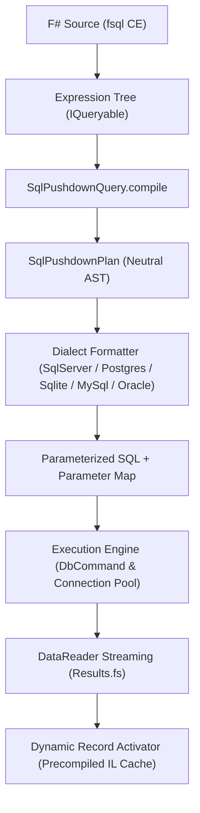

# FSQL (F# Structured Query Language) Specification
## Comprehensive Technical Specification for DQL (Data Query Language) & Multi-Dialect SQL Compilation

**Specification Version:** 1.1.0  
**Status:** Canonical / Active  
**Scope:** Relational SQL Engines (SQL Server, PostgreSQL, SQLite, MySQL, MariaDB, Oracle) and In-Memory Analytical Providers  
**Target Standard:** ANSI SQL:2016 / ISO/IEC 9075 DQL Compliant  
**Date:** November 2026  

---

## 1. Overview & Architectural Scope

### 1.1 Definition
**FSQL** (F# Structured Query Language) is a declarative, strongly-typed domain-specific language (DSL) embedded natively in F# through *Computation Expressions* (`fsql { ... }`) and LINQ Expression Trees / Quotations. FSQL provides a unified, dialect-agnostic Data Query Language (DQL) specification designed to compile high-level functional queries directly into optimized, native SQL statements (Universal SQL Pushdown), guaranteeing compile-time type safety, automated parameterization, and zero-allocation streaming execution.

### 1.2 Core Design Principles
1. **Compile-Time Type Safety & IntelliSense**: Every FSQL query is checked at compile/typecheck time against database schema metadata, eliminating common runtime errors such as misspelled column names, invalid joins, or type mismatches.
2. **Universal SQL Pushdown**: All filtering, projection, joining, ordering, grouping, aggregation, windowing, and pagination operations are pushed down to the underlying database engine. Only projected columns and matched rows are transmitted across the network or loaded into process memory.
3. **Strict Parameterization & Immunity to SQL Injection**: Dynamic literals, captured F# variables, and closure values are automatically converted into isolated, typed command parameters (`@p0`, `@p1`), preventing SQL injection by design.
4. **Dialect Independence**: A single canonical FSQL expression executes identically across **SQL Server**, **PostgreSQL**, **SQLite**, **MySQL**, **MariaDB**, and **Oracle**, emitting idiomatic dialect-specific SQL for each target engine.

---

## 2. Formal Grammar & Syntax Specification

FSQL queries are expressed through the `fsql { ... }` computation expression builder or fluent queryable extensions.

### 2.1 Extended Backus-Naur Form (EBNF)

```ebnf
FSqlQueryExpression ::=
    [ CteClause ]
    "fsql" "{"
        SourceIterationClause
        { JoinClause | ApplyClause }
        { WhereClause | ExistsClause | InClause }
        [ GroupByClause ]
        [ HavingClause ]
        [ WindowClause ]
        [ OrderByClause ]
        [ LimitOffsetClause ]
        [ LockHintClause ]
        SelectClause
    "}"
    [ SetOperationClause FSqlQueryExpression ]
    | "fsql" "{"
        SourceIterationClause
        TerminalAggregateClause
      "}" ;

CteClause ::=
    "withCte" Identifier "=" NestedFSqlExpression { "and" Identifier "=" NestedFSqlExpression }
    | "withRecursive" Identifier "=" NestedFSqlExpression ;

SourceIterationClause ::=
    "for" Identifier "in" QuerySource "do" ;

QuerySource ::=
    QualifiedIdentifier | NestedFSqlExpression ;

WhereClause ::=
    "where" "(" BooleanExpression ")" ;

ExistsClause ::=
    ( "whereExists" | "whereNotExists" ) "(" NestedFSqlExpression ")" ;

InClause ::=
    ( "whereIn" | "whereNotIn" ) "(" ColumnExpression "," ( NestedFSqlExpression | LiteralSequence ) ")" ;

JoinClause ::=
    "join" Identifier "in" QuerySource "on" "(" KeyExpression "=" KeyExpression ")"
    | "leftOuterJoin" Identifier "in" QuerySource "on" "(" KeyExpression "=" KeyExpression ")" "into" Identifier
      "for" Identifier "in" Identifier ".DefaultIfEmpty()" "do"
    | "rightOuterJoin" Identifier "in" QuerySource "on" "(" KeyExpression "=" KeyExpression ")" "into" Identifier
      "for" Identifier "in" Identifier ".DefaultIfEmpty()" "do"
    | "fullOuterJoin" Identifier "in" QuerySource "on" "(" KeyExpression "=" KeyExpression ")" "into" Identifier
      "for" Identifier "in" Identifier ".DefaultIfEmpty()" "do"
    | "crossJoin" Identifier "in" QuerySource "do" ;

ApplyClause ::=
    ( "crossApply" | "lateral" ) "(" NestedFSqlExpression ")"
    | ( "outerApply" | "leftLateral" ) "(" NestedFSqlExpression [ "," "onClause" "=" Expression ] ")" ;

GroupByClause ::=
    "groupBy" GroupKeyExpression "into" Identifier
    | "groupByRollup" GroupKeyExpressionList "into" Identifier
    | "groupByCube" GroupKeyExpressionList "into" Identifier
    | "groupByGroupingSets" GroupingSetsList "into" Identifier ;

HavingClause ::=
    "having" "(" BooleanExpression ")" ;

WindowClause ::=
    "over" "(" [ "partitionBy" PartitionExpressionList ] [ "orderBy" WindowOrderList ] [ WindowFrameClause ] ")" ;

WindowFrameClause ::=
    ( "rows" | "range" ) "between" FrameBound "and" FrameBound ;

OrderByClause ::=
    ( "sortBy" | "sortByDescending" ) SortKeyExpression [ NullOrderModifier ]
    { ( "thenBy" | "thenByDescending" ) SortKeyExpression [ NullOrderModifier ] } ;

NullOrderModifier ::=
    "nullsFirst" | "nullsLast" ;

LimitOffsetClause ::=
    [ "distinct" ]
    [ "skip" IntegerExpression ]
    [ "take" IntegerExpression [ "withTies" ] ] ;

SelectClause ::=
    "select" ( AnonymousRecordExpression | TupleExpression | Identifier | ScalarSubqueryExpression ) ;

SetOperationClause ::=
    "union" | "unionAll" | "intersect" | "except" ;

LockHintClause ::=
    "forUpdate" | "forShare" | "noWait" | "skipLocked" | "withNoLock" ;

TerminalAggregateClause ::=
    "count"
    | "countCol" Identifier
    | "countDistinct" Identifier
    | "sumBy" NumericExpression
    | "minBy" ComparableExpression
    | "maxBy" ComparableExpression
    | "averageBy" NumericExpression ;
```

---

## 3. Language Clauses & Semantic Operations

### 3.1 Source Iteration (`for ... in ... do`)
Defines the primary data source or relational table:
```fsharp
for c in Connections.sql.SampleStore.Customers do
```
- **Semantics:** Establishes table alias `_t0` and emits `FROM [Customers] AS _t0`.

### 3.2 Tuple Filtering (`where`)
Filters rows at the source prior to grouping and aggregation:
```fsharp
where (c.Country = "Brazil" && c.Age >= 21)
```
- **Semantics:** Compiles to predicate conditions inside the `WHERE` clause.
- **Parameter Extraction:** Captured values (`"Brazil"`, `21`) are lifted into parameterized bindings (`@p0`, `@p1`). Logical `&&` and `||` map to SQL `AND` and `OR`.

### 3.3 Range & Pattern Matching Predicates
- **Range (`between` / `>= && <=`):**
  ```fsharp
  where (c.Age >= 18 && c.Age <= 65)
  // or fluent: c.Age.Between(18, 65)
  ```
  Translates to `WHERE (_t0.Age BETWEEN @p0 AND @p1)`.
- **Pattern Matching (`LIKE` / `ILIKE`):**
  ```fsharp
  where (c.Email.EndsWith("@acme.org") || c.FirstName.StartsWith("Al"))
  ```
  Translates to `WHERE (_t0.Email LIKE @p0 OR _t0.FirstName LIKE @p1)`. In PostgreSQL, case-insensitive variants compile to `ILIKE`.

### 3.4 Correlated Existence Tests (`whereExists` and `whereNotExists`)
Enables declarative `EXISTS` and `NOT EXISTS` subqueries in pure F# syntax:
```fsharp
whereExists (fsql { for o in Connections.sql.SampleStore.Orders do where (o.CustomerId = c.Id && o.TotalAmount >= 100.0f) })
```
- **Semantics:** Translates to `WHERE EXISTS (SELECT 1 FROM Orders _sub1 WHERE (_sub1.CustomerId = _t0.Id AND _sub1.TotalAmount >= @p0))`.
- **Optimization Guarantee:** The subquery projection is rewritten to `SELECT 1`, preventing redundant column transmission or memory overhead.

### 3.5 Set Membership Tests (`whereIn` and `whereNotIn`)
Filters rows based on membership in a subquery or literal array:
```fsharp
where (discountedOrders.Contains(o.Id))
// or fluent: query.WhereIn("CustomerId", highValueCustomersSubquery)
// or literal sequence: query.WhereIn("Status", [ "Pending"; "Processing" ])
```
- **Subquery Semantics:** `WHERE _t0.CustomerId IN (SELECT _sub1.Id FROM ...)`
- **Literal Sequence Semantics:** `WHERE _t0.Status IN (@p0, @p1)`
- **Negative Semantics:** `NOT IN` automatically protects against NULL expansion traps.

---

## 4. Relational Joins & Cartesian Operations

### 4.1 Inner Join (`join ... on ...`)
```fsharp
join o in Connections.sql.SampleStore.Orders on (c.Id = o.CustomerId)
```
- **Semantics:** Emits `INNER JOIN [Orders] AS _t1 ON (_t0.Id = _t1.CustomerId)`.
- **Composite Keys:** Supported via tuple equality: `on ((t.StoreId, t.Region) = (tgt.StoreId, tgt.Region))`.

### 4.2 Left Outer Join (`leftOuterJoin`)
```fsharp
leftOuterJoin o in Connections.sql.SampleStore.Orders on (c.Id = o.CustomerId) into g
for o in g.DefaultIfEmpty() do
```
- **Semantics:** Lowered via LINQ `GroupJoin` and `DefaultIfEmpty` into `LEFT OUTER JOIN [Orders] AS _t1 ON (_t0.Id = _t1.CustomerId)`.
- **Null Safety:** Field accesses on `o` are guarded via `isNull` or coalesce expressions, mapping to SQL `COALESCE` or `CASE WHEN`.

### 4.3 Right Outer Join & Full Outer Join
```fsharp
rightOuterJoin o in Connections.sql.SampleStore.Orders on (c.Id = o.CustomerId) into g
for o in g.DefaultIfEmpty() do
```
- **Right Outer Join:** `RIGHT OUTER JOIN [Orders] AS _t1 ON (_t0.Id = _t1.CustomerId)`
- **Full Outer Join:** `FULL OUTER JOIN [Orders] AS _t1 ON (_t0.Id = _t1.CustomerId)`
- *Note:* SQLite does not support `RIGHT JOIN` or `FULL OUTER JOIN` natively prior to 3.39+. The compiler routes queries on SQLite to managed emulation or reports an informative dialect capability error.

### 4.4 Cross Join (Cartesian Product)
```fsharp
crossJoin p in Connections.sql.SampleStore.Products do
```
- **Semantics:** Emits `CROSS JOIN [Products] AS _t1`.

---

## 5. Correlated Row-Level Joins (`crossApply` and `outerApply`)

### 5.1 `crossApply` / `lateral`
Correlates each outer row with a parameterized subquery:
```fsharp
crossApply (fsql {
    for o in Connections.sql.SampleStore.Orders do
    where (o.CustomerId = c.Id)
    sortByDescending o.OrderDate
    take 1
    select o
})
```
- **SQL Server:** `CROSS APPLY (SELECT TOP (1) ... WHERE _sub1.CustomerId = _t0.Id ORDER BY _sub1.OrderDate DESC) AS _t1`.
- **PostgreSQL / MySQL 8.0+ / Oracle 12c+:** `CROSS JOIN LATERAL (SELECT ... WHERE _sub1.CustomerId = _t0.Id ORDER BY _sub1.OrderDate DESC LIMIT 1) AS _t1`.
- **SQLite:** Evaluated via scalar subquery in projection or managed fallback where lateral `FROM` expressions are unsupported.

### 5.2 `outerApply` / `leftLateral`
Preserves outer rows even when the correlated subquery returns zero rows:
```fsharp
outerApply (fsql {
    for o in Connections.sql.SampleStore.Orders do
    where (o.CustomerId = c.Id)
    sortByDescending o.OrderDate
    take 1
    select o
})
```
- **SQL Server:** `OUTER APPLY (SELECT TOP (1) ... ) AS _t1`
- **PostgreSQL:** `LEFT JOIN LATERAL (SELECT ... ) AS _t1 ON true`
- **SQLite:** `LEFT JOIN (...) AS _t1 ON 1=1`

---

## 6. Grouping, Having & Multidimensional Aggregation

### 6.1 Standard `groupBy` and `having`
```fsharp
groupBy o.CustomerId into g
having (fsql { for item in g do count } >= 5)
select {|
    CustomerId = g.Key
    TotalOrders = fsql { for item in g do count }
    TotalSpent = g.Sum(fun x -> x.TotalAmount)
|}
```
- **Semantics:**
  - `groupBy` produces the `GROUP BY _t0.CustomerId` clause.
  - `having` produces the dedicated `HAVING (COUNT(*) >= @p0)` clause without polluting `WHERE`.

### 6.2 Distinct & Column-Specific Aggregates
- **`COUNT(*)`:** `count` -> `COUNT(*)`
- **`COUNT(col)`:** `query.Count("Email")` -> `COUNT(_t0.Email)` (counts non-null entries only)
- **`COUNT(DISTINCT col)`:** `query.CountDistinct("Country")` -> `COUNT(DISTINCT _t0.Country)`
- **`SUM(DISTINCT col)`:** `query.SumDistinct("Amount")` -> `SUM(DISTINCT _t0.Amount)`

### 6.3 Multidimensional Rollup, Cube & Grouping Sets
For business intelligence and subtotal calculation:
```fsharp
groupByRollup [ "Region"; "Department" ] into g
```
- **SQL Server / PostgreSQL / Oracle:** `GROUP BY ROLLUP (_t0.Region, _t0.Department)`
- **MySQL:** `GROUP BY _t0.Region, _t0.Department WITH ROLLUP`
- **SQLite:** Emulated via concatenated `UNION ALL` grouping blocks.

### 6.4 String Aggregation (`stringAgg` / `groupConcat`)
Concatenates grouped string columns:
```fsharp
select {|
    CustomerId = g.Key
    ProductList = g.StringAgg((fun x -> x.ProductName), ", ")
|}
```
- **SQL Server / PostgreSQL:** `STRING_AGG(_t0.ProductName, ', ')`
- **SQLite / MySQL:** `GROUP_CONCAT(_t0.ProductName, ', ')`
- **Oracle:** `LISTAGG(_t0.ProductName, ', ') WITHIN GROUP (ORDER BY _t0.ProductName)`

---

## 7. Window & Analytical Functions (OLAP DQL)

Window functions perform calculations across a set of table rows that are related to the current row without collapsing them into a single summary row:

### 7.1 Syntax & Partitioning
```fsharp
select {|
    OrderId = o.Id
    CustomerId = o.CustomerId
    Amount = o.TotalAmount
    // ROW_NUMBER() OVER (PARTITION BY o.CustomerId ORDER BY o.OrderDate DESC)
    OrderSeq = Window.rowNumber (Window.partitionBy o.CustomerId |> Window.orderByDescending o.OrderDate)
    // Running total: SUM(o.TotalAmount) OVER (PARTITION BY o.CustomerId ORDER BY o.OrderDate)
    RunningTotal = Window.sum o.TotalAmount (Window.partitionBy o.CustomerId |> Window.orderBy o.OrderDate)
    // Lead/Lag: Previous order amount
    PrevAmount = Window.lag o.TotalAmount 1 (Window.partitionBy o.CustomerId |> Window.orderBy o.OrderDate)
|}
```

### 7.2 Analytical Function Catalog
| FSQL Function | ANSI SQL Equivalent | Target Engines |
|---|---|---|
| `Window.rowNumber` | `ROW_NUMBER() OVER (...)` | All |
| `Window.rank` | `RANK() OVER (...)` | All |
| `Window.denseRank` | `DENSE_RANK() OVER (...)` | All |
| `Window.ntile k` | `NTILE(k) OVER (...)` | All |
| `Window.lag col n [default]` | `LAG(col, n, def) OVER (...)` | All |
| `Window.lead col n [default]` | `LEAD(col, n, def) OVER (...)` | All |
| `Window.firstValue col` | `FIRST_VALUE(col) OVER (...)` | All |
| `Window.lastValue col` | `LAST_VALUE(col) OVER (...)` | All |
| `Window.sum / avg / min / max` | `SUM(col) OVER (...)` | All |

---

## 8. Compound Set Operations (`UNION`, `INTERSECT`, `EXCEPT`)

FSQL supports declarative set operations combining the results of two or more queries:

```fsharp
let customersInUS = fsql { for c in db.Customers do where (c.Country = "USA"); select c.Email }
let customersInEU = fsql { for c in db.Customers do where (c.Country = "Germany"); select c.Email }

// Combine without duplicates
let allEmails = customersInUS.Union(customersInEU)

// Combine preserving duplicates
let allAuditEmails = customersInUS.UnionAll(customersInEU)

// Intersection
let sharedEmails = customersInUS.Intersect(customersInEU)

// Difference
let exclusiveUSEmails = customersInUS.Except(customersInEU)
```
- **Semantics:**
  - `Union` -> `SELECT ... UNION SELECT ...`
  - `UnionAll` -> `SELECT ... UNION ALL SELECT ...`
  - `Intersect` -> `SELECT ... INTERSECT SELECT ...`
  - `Except` -> `SELECT ... EXCEPT SELECT ...` (In Oracle: `MINUS`).

---

## 9. Common Table Expressions (CTEs)

CTEs provide modular, readable query decomposition and recursive hierarchy traversal:

### 9.1 Non-Recursive CTE
```fsharp
withCte "HighValueOrders" (fsql {
    for o in db.Orders do
    where (o.TotalAmount >= 1000.0f)
    select o
}) (fun hvo ->
    fsql {
        for c in db.Customers do
        join o in hvo on (c.Id = o.CustomerId)
        select {| c.Name; o.TotalAmount |}
    }
)
```
- **Semantics:**
  ```sql
  WITH HighValueOrders AS (
    SELECT _t0.Id, _t0.CustomerId, _t0.TotalAmount FROM Orders _t0 WHERE (_t0.TotalAmount >= 1000.0)
  )
  SELECT _t1.Name, _t2.TotalAmount
  FROM Customers _t1
  INNER JOIN HighValueOrders _t2 ON (_t1.Id = _t2.CustomerId)
  ```

### 9.2 Recursive CTE
Used for organizational hierarchies, bill-of-materials, and graph pathfinding:
```sql
WITH RECURSIVE Subordinates AS (
  SELECT Id, ManagerId, Name, 1 AS Level FROM Employees WHERE ManagerId IS NULL
  UNION ALL
  SELECT e.Id, e.ManagerId, e.Name, s.Level + 1 FROM Employees e JOIN Subordinates s ON e.ManagerId = s.Id
)
SELECT * FROM Subordinates;
```

---

## 10. Sorting, Null Ordering & Slicing

### 10.1 Multi-Column Sorting
```fsharp
sortBy c.Country
thenByDescending c.City
```
- **Semantics:** `ORDER BY _t0.Country ASC, _t0.City DESC`

### 10.2 Null Ordering (`nullsFirst` and `nullsLast`)
```fsharp
sortBy c.ExpirationDate
nullsLast
```
- **PostgreSQL / Oracle / SQLite 3.30+:** `ORDER BY _t0.ExpirationDate ASC NULLS LAST`
- **SQL Server / MySQL:** Lowered via conditional CASE expression:
  `ORDER BY CASE WHEN _t0.ExpirationDate IS NULL THEN 1 ELSE 0 END, _t0.ExpirationDate ASC`

### 10.3 Pagination & Slicing (`take`, `skip`, `distinct`)
- **`take n`**: Restricts result set to at most $n$ rows.
- **`skip m`**: Bypasses the first $m$ rows.
- **`distinct`**: Emits `SELECT DISTINCT`.
- **`withTies`**: In SQL Server (`TOP (n) WITH TIES`) or Postgres/Oracle (`FETCH NEXT n ROWS WITH TIES`), includes all additional rows tying for the last position in `ORDER BY`.

---

## 11. Concurrency, Locking & Hints

Enterprise DQL requires transaction-level read locks and query hints:

```fsharp
fsql {
    for o in db.Orders do
    where (o.Id = orderId)
    forUpdate
    select o
}
```
| FSQL Modifier | SQL Server | PostgreSQL / MySQL / Oracle |
|---|---|---|
| `forUpdate` | `FROM Orders _t0 WITH (UPDLOCK, ROWLOCK)` | `FOR UPDATE` |
| `forShare` | `FROM Orders _t0 WITH (HOLDLOCK, ROWLOCK)` | `FOR SHARE` |
| `noWait` | `WITH (NOWAIT)` | `NOWAIT` |
| `skipLocked` | `WITH (READPAST)` | `SKIP LOCKED` |
| `withNoLock` | `WITH (NOLOCK)` | Ignored (Read Committed) |

---

## 12. Multi-Dialect Compilation Matrix

The FSQL compiler translates the neutral intermediate representation (`SqlPushdownPlan`) into dialect-specific SQL:

| FSQL Feature | SQL Server (T-SQL) | PostgreSQL | SQLite | MySQL / MariaDB | Oracle (12c+) |
|---|---|---|---|---|---|
| **Identifier Quoting** | `[Column]` | `"Column"` | `[Column]` or `"Column"` | `` `Column` `` | `"COLUMN"` |
| **Bound Parameter Syntax** | `@p0`, `@p1` | `@p0`, `@p1` | `@p0`, `@p1` | `?` or `@p0` | `:p0`, `:p1` |
| **Pagination (Take/Skip)** | `OFFSET m ROWS FETCH NEXT n ROWS ONLY` | `LIMIT n OFFSET m` | `LIMIT n OFFSET m` | `LIMIT n OFFSET m` | `OFFSET m ROWS FETCH NEXT n ROWS ONLY` |
| **Top without Offset** | `SELECT TOP (n) ...` | `SELECT ... LIMIT n` | `SELECT ... LIMIT n` | `SELECT ... LIMIT n` | `SELECT ... FETCH FIRST n ROWS ONLY` |
| **String Concatenation** | `+` (or `CONCAT`) | `||` | `||` | `CONCAT(a, b)` | `||` |
| **Correlated Apply** | `CROSS APPLY (...)` | `CROSS JOIN LATERAL (...)` | Correlated Scalar Subquery | `LATERAL (...)` | `CROSS APPLY (...)` |
| **Outer Apply** | `OUTER APPLY (...)` | `LEFT JOIN LATERAL (...) ON true` | `LEFT JOIN (...) ON 1=1` | `LEFT JOIN LATERAL (...) ON true` | `OUTER APPLY (...)` |
| **Boolean Logic** | `_t0.Active = 1` (`BIT`) | `_t0.active = TRUE` (`BOOLEAN`) | `_t0.Active <> 0` (`INTEGER`) | `_t0.active = 1` (`TINYINT`) | `_t0.ACTIVE = 1` (`NUMBER(1)`) |
| **Null Ordering** | `CASE WHEN col IS NULL THEN 1 ELSE 0 END` | `NULLS FIRST` / `NULLS LAST` | `NULLS FIRST` / `NULLS LAST` | `CASE WHEN col IS NULL ...` | `NULLS FIRST` / `NULLS LAST` |
| **Non-Null Column Count** | `COUNT([col])` | `COUNT("col")` | `COUNT([col])` | ``COUNT(`col`)`` | `COUNT("COL")` |
| **Distinct Column Count** | `COUNT(DISTINCT [col])` | `COUNT(DISTINCT "col")` | `COUNT(DISTINCT [col])` | ``COUNT(DISTINCT `col`)`` | `COUNT(DISTINCT "COL")` |
| **String Aggregation** | `STRING_AGG(col, delimiter)` | `STRING_AGG(col, delimiter)` | `GROUP_CONCAT(col, delimiter)` | `GROUP_CONCAT(col SEPARATOR d)` | `LISTAGG(col, d) WITHIN GROUP(...)` |
| **Set Difference** | `EXCEPT` | `EXCEPT` | `EXCEPT` | `EXCEPT` (8.0+) | `MINUS` |
| **Row Locking** | `WITH (UPDLOCK)` | `FOR UPDATE` | *N/A (Database-level lock)* | `FOR UPDATE` | `FOR UPDATE` |

---

## 13. Compiler Architecture & Execution Pipeline



### 13.1 Compilation Phases
1. **Expression Tree Capture**: The `fsql` builder captures the expression as a strongly-typed `System.Linq.Expressions.Expression` graph.
2. **Neutral Plan Lowering (`SqlPushdownPlan`)**:
   - Decomposes chained `MethodCallExpression` nodes (`Where`, `Select`, `OrderBy`, `GroupBy`, `Join`, `Take`, `Skip`).
   - Extracts filtering predicates, group keys, and final projection definitions.
   - Extracts literal values and closure references into a parameterized symbol table (`@p0`, `@p1`).
3. **Precedence & Collision Resolution**:
   - Ensures terminal aggregate calls (`count`, `sumBy`) retain aggregate projections (`COUNT(*)`) even when preceded by a `select p.Id` projection.
   - Automatically elides illegal `ORDER BY` clauses for single-row scalar aggregates without `GROUP BY` in SQL Server.
4. **Dialect-Specific Emission**:
   - Emits target delimiter quotes (`[ ]`, `" "`, `` ` ``).
   - Formats SQL clauses with clean indentation and line breaks for inspection via `toRawQuery`.
5. **Zero-Allocation Streaming Execution**:
   - Reuses pooled `DbConnection` instances via ADO.NET pools.
   - Streams data lazily via cursor enumeration (`Results.fs`).
   - Instantiates F# records through precompiled constructor delegates (`DynamicRecordActivator`), eliminating reflection overhead and transient object arrays.

---

## 14. Inspection & Diagnostic APIs

### 14.1 `toRawQuery` (Formatted SQL Inspection)
For debugging, execution plan auditing, and index tuning, FSQL provides the **`toRawQuery`** function:
```fsharp
let q =
    fsql {
        for c in Connections.sql.SampleStore.Customers do
        where (c.Country = "USA")
        whereExists (fsql { for o in Connections.sql.SampleStore.Orders do where (o.CustomerId = c.Id && o.TotalAmount >= 100.0f) })
        select {| Customer = c.FirstName + " " + c.LastName |}
    }

printfn "%s" (toRawQuery q)
```

**Structured Output with Parameter Header:**
```text
/*
  Parameters:
    @p0 (String) = "USA"
    @p1 (Single) = 100
*/
SELECT
  (_t0.FirstName || ' ' || _t0.LastName) AS Customer
FROM Customers _t0
WHERE (_t0.Country = @p0
  AND EXISTS (
    SELECT 1
    FROM Orders _sub1
    WHERE (_sub1.CustomerId = _t0.Id AND _sub1.TotalAmount >= @p1)
  ))
```

### 14.2 `toRawSql` (Tuple Extraction for Interop)
Returns the raw tuple `string * (string * obj) list`:
```fsharp
let sql, parameters = toRawSql q
```

---

## 15. Implementation & Conformance Rules

1. **No String Concatenation for Filters**: All query logic must be expressed through `where`, `having`, `whereExists`, or `crossApply`. Raw string interpolation inside queries is prohibited.
2. **Immutability of `SqlPushdownPlan`**: Every tree modification must yield an immutable, side-effect-free copy of the plan.
3. **Dialect Capability Enforcement**: Features unsupported by a database dialect (such as `RIGHT JOIN` or `CROSS JOIN LATERAL` in older SQLite releases) must trigger a clear explanatory error or safe managed fallback.
4. **AI Agent Compliance**: All autonomous agents generating queries must follow the [FSQL AI Agent Guide](FSQL_AI_AGENT_GUIDE.md).
