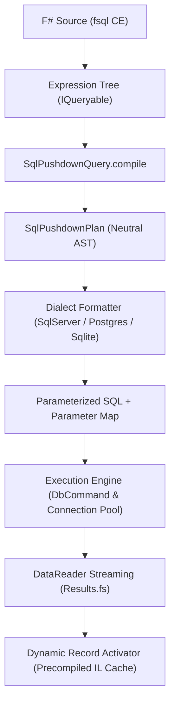

# FSQL (F# Structured Query Language) Specification
## Internal Technical Specification for Architecture & DQL Compilation

**Specification Version:** 1.0.0  
**Status:** Canonical / Active  
**Scope:** Relational SQL Engines (SQL Server, PostgreSQL, SQLite, MySQL, MariaDB, Oracle) and In-Memory Analytical Providers  
**Date:** November 2026  

---

## 1. Overview & Scope

### 1.1 Definition
**FSQL** (F# Structured Query Language) is a declarative, strongly-typed domain-specific language (DSL) embedded natively in F# through *Computation Expressions* and LINQ Expression Trees / Quotations. FSQL provides a unified, dialect-agnostic Data Query Language (DQL) specification designed to compile high-level F# functional queries directly into optimized, native SQL statements (Universal SQL Pushdown), guaranteeing compile-time type safety, automated parameterization, and zero-allocation streaming execution.

### 1.2 Core Design Principles
1. **Compile-Time Type Safety & IntelliSense**: Every FSQL query is checked at compile/typecheck time against database schema metadata, eliminating common runtime errors such as misspelled column names, invalid joins, or type mismatches.
2. **Universal SQL Pushdown**: All filtering, projection, joining, ordering, grouping, aggregation, and pagination operations are pushed down to the underlying database engine. Only projected columns and matched rows are transmitted across the network or loaded into process memory.
3. **Strict Parameterization & Immunity to SQL Injection**: Dynamic literals, captured F# variables, and closure values are automatically converted into isolated, typed command parameters (`@p0`, `@p1`), preventing SQL injection by design.
4. **Dialect Independence**: A single canonical FSQL expression executes identically across **SQL Server**, **PostgreSQL**, **SQLite**, **MySQL**, **MariaDB**, and **Oracle**, emitting idiomatic dialect-specific SQL for each target engine.

---

## 2. Formal Grammar & Syntax Specification

FSQL queries are expressed through the `fsql { ... }` computation expression builder.

### 2.1 Extended Backus-Naur Form (EBNF)

```ebnf
FSqlQueryExpression ::=
    "fsql" "{"
        SourceIterationClause
        { JoinClause | ApplyClause }
        { WhereClause | ExistsClause }
        [ GroupByClause ]
        [ HavingClause ]
        [ OrderByClause ]
        [ LimitOffsetClause ]
        SelectClause
    "}"
    | "fsql" "{"
        SourceIterationClause
        TerminalAggregateClause
      "}" ;

SourceIterationClause ::=
    "for" Identifier "in" QuerySource "do" ;

QuerySource ::=
    QualifiedIdentifier | NestedFSqlExpression ;

WhereClause ::=
    "where" "(" BooleanExpression ")" ;

ExistsClause ::=
    ( "whereExists" | "whereNotExists" ) "(" NestedFSqlExpression ")" ;

JoinClause ::=
    "join" Identifier "in" QuerySource "on" "(" KeyExpression "=" KeyExpression ")"
    | "leftOuterJoin" Identifier "in" QuerySource "on" "(" KeyExpression "=" KeyExpression ")" "into" Identifier
      "for" Identifier "in" Identifier ".DefaultIfEmpty()" "do" ;

ApplyClause ::=
    ( "crossApply" | "lateral" ) "(" NestedFSqlExpression ")" ;

GroupByClause ::=
    "groupBy" GroupKeyExpression "into" Identifier ;

HavingClause ::=
    "having" "(" BooleanExpression ")" ;

OrderByClause ::=
    ( "sortBy" | "sortByDescending" ) SortKeyExpression
    { ( "thenBy" | "thenByDescending" ) SortKeyExpression } ;

LimitOffsetClause ::=
    [ "distinct" ]
    [ "skip" IntegerExpression ]
    [ "take" IntegerExpression ] ;

SelectClause ::=
    "select" ( AnonymousRecordExpression | TupleExpression | Identifier ) ;

TerminalAggregateClause ::=
    "count"
    | "sumBy" NumericExpression
    | "minBy" ComparableExpression
    | "maxBy" ComparableExpression
    | "averageBy" NumericExpression ;
```

---

## 3. Language Clauses & Semantic Operations

### 3.1 Source Iteration (`for ... in ... do`)
Defines the primary data source or relational table:
```fsharp
for c in Connections.sql.SampleStore.Customers do
```
- **Semantics:** Establishes table alias `_t0` and emits `FROM [Customers] AS _t0`.

### 3.2 Tuple Filtering (`where`)
Filters rows at the source prior to grouping and aggregation:
```fsharp
where (c.Country = "Brazil" && c.Age >= 21)
```
- **Semantics:** Compiles to predicate conditions inside the `WHERE` clause.
- **Parameter Extraction:** Captured values (`"Brazil"`, `21`) are lifted into parameterized bindings (`@p0`, `@p1`). Logical `&&` and `||` map to SQL `AND` and `OR`.

### 3.3 Correlated Existence Tests (`whereExists` and `whereNotExists`)
Enables declarative `EXISTS` and `NOT EXISTS` subqueries in pure F# syntax:
```fsharp
whereExists (fsql { for o in Connections.sql.SampleStore.Orders do where (o.CustomerId = c.Id && o.TotalAmount >= 100.0f) })
```
- **Semantics:** Translates to `WHERE EXISTS (SELECT 1 FROM Orders _sub1 WHERE (_sub1.CustomerId = _t0.Id AND _sub1.TotalAmount >= @p0))`.
- **Optimization Guarantee:** The subquery projection is rewritten to `SELECT 1`, preventing redundant column transmission or memory overhead.

### 3.4 Relational Joins (`join` and `leftOuterJoin`)
#### 3.4.1 Inner Join
```fsharp
join o in Connections.sql.SampleStore.Orders on (c.Id = o.CustomerId)
```
- **Semantics:** Generates `INNER JOIN [Orders] AS _t1 ON (_t0.Id = _t1.CustomerId)`.
- Supports composite keys via tuple syntax: `on ((t.StoreId, t.Region) = (tgt.StoreId, tgt.Region))`.

#### 3.4.2 Left Outer Join
```fsharp
leftOuterJoin o in Connections.sql.SampleStore.Orders on (c.Id = o.CustomerId) into g
for o in g.DefaultIfEmpty() do
```
- **Semantics:** Lowered via LINQ `GroupJoin` and `DefaultIfEmpty` into `LEFT OUTER JOIN [Orders] AS _t1 ON (_t0.Id = _t1.CustomerId)`.
- Null checks and fallback expressions compile natively to SQL `COALESCE` or `CASE WHEN ... THEN ... ELSE ... END`.

### 3.5 Correlated Row-Level Joins (`crossApply` and `lateral`)
Correlates each outer row with a parameterized subquery (e.g., retrieving the top $N$ latest orders per customer):
```fsharp
crossApply (fsql {
    for o in Connections.sql.SampleStore.Orders do
    where (o.CustomerId = c.Id)
    sortByDescending o.OrderDate
    take 1
    select o
})
```
- **SQL Server:** `CROSS APPLY (SELECT TOP (1) ... WHERE _sub1.CustomerId = _t0.Id ORDER BY _sub1.OrderDate DESC) AS _t1`.
- **PostgreSQL / MySQL 8.0+:** `CROSS JOIN LATERAL (SELECT ... WHERE _sub1.CustomerId = _t0.Id ORDER BY _sub1.OrderDate DESC LIMIT 1) AS _t1`.
- **SQLite:** Evaluated via scalar sub-select in projection or managed fallback where lateral `FROM` expressions are not supported.

### 3.6 Grouping & Aggregate Filtering (`groupBy` and `having`)
```fsharp
groupBy o.CustomerId into g
having (fsql { for item in g do count } >= 5)
select {|
    CustomerId = g.Key
    TotalOrders = fsql { for item in g do count }
    TotalSpent = g.Sum(fun x -> x.TotalAmount)
|}
```
- **Semantics:**
  - `groupBy` produces the `GROUP BY _t0.CustomerId` clause.
  - `having` produces the dedicated `HAVING (COUNT(*) >= @p0)` clause without polluting `WHERE`.
  - Projections capture key values and aggregate calls (`COUNT(*)`, `SUM(_t0.TotalAmount)`).

### 3.7 Scalar Subqueries in `select` Projections
FSQL allows embedding correlated scalar subqueries directly within anonymous records:
```fsharp
select {|
    CustomerName = c.FirstName + " " + c.LastName
    OrderCount = fsql { for o in Connections.sql.SampleStore.Orders do where (o.CustomerId = c.Id); count }
|}
```
- **Semantics:** Compiles directly to an inline scalar sub-select:
  ```sql
  SELECT
    (_t0.FirstName || ' ' || _t0.LastName) AS CustomerName,
    (SELECT COUNT(*) FROM Orders _sub1 WHERE (_sub1.CustomerId = _t0.Id)) AS OrderCount
  FROM Customers _t0
  ```

---

## 4. Multi-Dialect Compilation Matrix

The FSQL compiler translates the neutral intermediate representation (`SqlPushdownPlan`) into dialect-specific SQL:

| FSQL Feature | SQL Server (T-SQL) | PostgreSQL | SQLite | MySQL / MariaDB | Oracle (12c+) |
|---|---|---|---|---|---|
| **Identifier Quoting** | `[Column]` | `"Column"` | `[Column]` or `"Column"` | `` `Column` `` | `"COLUMN"` |
| **Bound Parameter Syntax** | `@p0`, `@p1` | `@p0`, `@p1` | `@p0`, `@p1` | `?` or `@p0` | `:p0`, `:p1` |
| **Pagination (Take/Skip)** | `OFFSET m ROWS FETCH NEXT n ROWS ONLY` | `LIMIT n OFFSET m` | `LIMIT n OFFSET m` | `LIMIT n OFFSET m` | `OFFSET m ROWS FETCH NEXT n ROWS ONLY` |
| **Top without Offset** | `SELECT TOP (n) ...` | `SELECT ... LIMIT n` | `SELECT ... LIMIT n` | `SELECT ... LIMIT n` | `SELECT ... FETCH FIRST n ROWS ONLY` |
| **String Concatenation** | `+` (or `CONCAT`) | `||` | `||` | `CONCAT(a, b)` | `||` |
| **Correlated Apply** | `CROSS APPLY (...)` | `CROSS JOIN LATERAL (...)` | Correlated Scalar Subquery | `LATERAL (...)` | `CROSS APPLY (...)` |
| **Boolean Logic** | `_t0.Active = 1` (`BIT`) | `_t0.active = TRUE` (`BOOLEAN`) | `_t0.Active <> 0` (`INTEGER`) | `_t0.active = 1` (`TINYINT`) | `_t0.ACTIVE = 1` (`NUMBER(1)`) |
| **Non-Null Column Count** | `COUNT([col])` | `COUNT("col")` | `COUNT([col])` | ``COUNT(`col`)`` | `COUNT("COL")` |
| **Distinct Column Count** | `COUNT(DISTINCT [col])` | `COUNT(DISTINCT "col")` | `COUNT(DISTINCT [col])` | ``COUNT(DISTINCT `col`)`` | `COUNT(DISTINCT "COL")` |

---

## 5. Compiler Architecture & Execution Pipeline



### 5.1 Compilation Phases
1. **Expression Tree Capture**: The `fsql` builder captures the expression as a strongly-typed `System.Linq.Expressions.Expression` graph.
2. **Neutral Plan Lowering (`SqlPushdownPlan`)**:
   - Decomposes chained `MethodCallExpression` nodes (`Where`, `Select`, `OrderBy`, `GroupBy`, `Join`, `Take`, `Skip`).
   - Extracts filtering predicates, group keys, and final projection definitions.
   - Extracts literal values and closure references into a parameterized symbol table (`@p0`, `@p1`).
3. **Precedence & Collision Resolution**:
   - Ensures terminal aggregate calls (`count`, `sumBy`) retain aggregate projections (`COUNT(*)`) even when preceded by a `select p.Id` projection.
   - Automatically elides illegal `ORDER BY` clauses for single-row scalar aggregates without `GROUP BY` in SQL Server.
4. **Dialect-Specific Emission**:
   - Emits target delimiter quotes (`[ ]`, `" "`, `` ` ``).
   - Formats SQL clauses with clean indentation and line breaks for inspection via `toRawQuery`.
5. **Zero-Allocation Streaming Execution**:
   - Reuses pooled `DbConnection` instances via ADO.NET pools.
   - Streams data lazily via cursor enumeration (`Results.fs`).
   - Instantiates F# records through precompiled constructor delegates (`DynamicRecordActivator`), eliminating reflection overhead and transient object arrays.

---

## 6. Inspection & Diagnostic APIs

### 6.1 `toRawQuery` (Formatted SQL Inspection)
For debugging, execution plan auditing, and index tuning, FSQL provides the **`toRawQuery`** function:
```fsharp
let q =
    fsql {
        for c in Connections.sql.SampleStore.Customers do
        where (c.Country = "USA")
        whereExists (fsql { for o in Connections.sql.SampleStore.Orders do where (o.CustomerId = c.Id && o.TotalAmount >= 100.0f) })
        select {| Customer = c.FirstName + " " + c.LastName |}
    }

printfn "%s" (toRawQuery q)
```

**Structured Output with Parameter Header:**
```text
/*
  Parameters:
    @p0 (String) = "USA"
    @p1 (Single) = 100
*/
SELECT
  (_t0.FirstName || ' ' || _t0.LastName) AS Customer
FROM Customers _t0
WHERE (_t0.Country = @p0
  AND EXISTS (
    SELECT 1
    FROM Orders _sub1
    WHERE (_sub1.CustomerId = _t0.Id AND _sub1.TotalAmount >= @p1)
  ))
```

### 6.2 `toRawSql` (Tuple Extraction for Interop)
Returns the raw tuple `string * (string * obj) list`:
```fsharp
let sql, parameters = toRawSql q
```

---

## 7. Implementation & Conformance Rules

1. **No String Concatenation for Filters**: All query logic must be expressed through `where`, `having`, `whereExists`, or `crossApply`. Raw string interpolation inside queries is prohibited.
2. **Immutability of `SqlPushdownPlan`**: Every tree modification must yield an immutable, side-effect-free copy of the plan.
3. **Dialect Enforcement**: Features unsupported by a database dialect (such as `RIGHT JOIN` or `CROSS JOIN LATERAL` in older SQLite releases) must trigger a clear explanatory error or safe managed fallback.
4. **AI Agent Compliance**: All autonomous agents generating queries must follow the [FSQL AI Agent Guide](FSQL_AI_AGENT_GUIDE.md).
