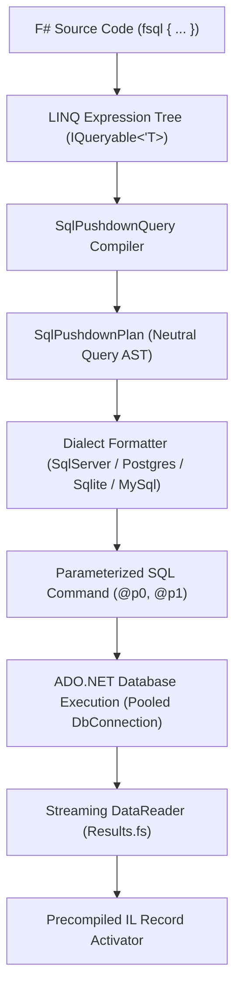

# FSQL Language Specification

> **Document Type**: Internal Technical Language Specification  
> **Specification Version**: 1.0  
> **Status**: Canonical  
> **Applies to**: F# Query Studio Universal Query Engine  
> **Target Dialects**: SQL Server, PostgreSQL, SQLite, MySQL  

---

## 1. Overview & Architecture

### 1.1 Definition
**FSQL** (F# Structured Query Language) is a declarative, strongly-typed domain-specific language (DSL) embedded natively in F# through the `fsql { ... }` computation expression. FSQL serves as the canonical Data Query Language (DQL) for F# Query Studio, compiling functional query expressions directly into optimized, native SQL statements executed on the target database engine (Universal SQL Pushdown).

### 1.2 Core Design Principles
1. **Compile-Time Type Safety**: Queries are verified by the F# compiler and language service against database schema metadata. Column typos, invalid joins, and type mismatches fail at compile time.
2. **Universal SQL Pushdown**: Filters (`where`), existence checks (`whereExists`), joins (`join`, `leftOuterJoin`), groupings (`groupBy`), aggregate filters (`having`), sorting (`sortBy`), and pagination (`take`, `skip`) are pushed down to the database engine. Only requested columns and filtered rows traverse the network.
3. **Strict Parameterization**: Literals and closure variables in query predicates are automatically extracted and bound as typed parameters (`@p0`, `@p1`), preventing SQL injection attacks entirely.
4. **Dialect Independence**: The same FSQL code compiles to dialect-specific SQL for SQL Server (T-SQL), PostgreSQL, SQLite, and MySQL without requiring user-side query modifications.

### 1.3 Compilation Pipeline



---

## 2. Formal Grammar (EBNF)

The formal grammar of the `fsql { ... }` computation expression corresponds to valid F# computation expression syntax extending `Microsoft.FSharp.Linq.QueryBuilder`:

```ebnf
FSqlExpression ::=
    "fsql" "{"
        SourceClause
        { JoinClause }
        { FilterClause }
        [ GroupByClause ]
        [ HavingClause ]
        [ OrderByClause ]
        [ PagingClause ]
        ProjectionClause
    "}"
    | "fsql" "{"
        SourceClause
        TerminalAggregateClause
      "}" ;

SourceClause ::=
    "for" Identifier "in" QuerySource "do" ;

QuerySource ::=
    QualifiedIdentifier | "(" FSqlExpression ")" ;

JoinClause ::=
    "join" Identifier "in" QuerySource "on" "(" KeyExpression "=" KeyExpression ")"
    | "leftOuterJoin" Identifier "in" QuerySource "on" "(" KeyExpression "=" KeyExpression ")" "into" Identifier
      "for" Identifier "in" Identifier ".DefaultIfEmpty()" "do"
    | "for" Identifier "in" "(" "crossApply" "(" FSqlExpression ")" ")" "do"
    | "for" Identifier "in" "(" "lateral" "(" FSqlExpression ")" ")" "do" ;

FilterClause ::=
    "where" "(" BooleanExpression ")"
    | "whereExists" "(" FSqlExpression ")"
    | "whereNotExists" "(" FSqlExpression ")" ;

GroupByClause ::=
    "groupBy" Expression "into" Identifier ;

HavingClause ::=
    "having" "(" BooleanExpression ")" ;

OrderByClause ::=
    ( "sortBy" | "sortByDescending" ) Expression
    { ( "thenBy" | "thenByDescending" ) Expression } ;

PagingClause ::=
    [ "distinct" ]
    [ "skip" IntegerExpression ]
    [ "take" IntegerExpression ] ;

ProjectionClause ::=
    "select" ( AnonymousRecord | Tuple | Identifier ) ;

TerminalAggregateClause ::=
    "count"
    | "sumBy" NumericExpression
    | "minBy" ComparableExpression
    | "maxBy" ComparableExpression
    | "averageBy" NumericExpression
    | "head"
    | "nth" IntegerExpression ;
```

---

## 3. Query Sources & Data Binding

### 3.1 Primary Table Iteration
Queries begin with a `for ... in ... do` clause binding a typed collection from `Connections`:
```fsharp
fsql {
    for c in Connections.sql.SampleStore.Customers do
    select c
}
```
- **Generated SQL:** `SELECT _t0.* FROM Customers _t0`
- **Aliasing:** The base source is assigned the table alias `_t0`.

### 3.2 Subquery Sources (Derived Tables)
An `fsql` expression can iterate over an inner `fsql` expression:
```fsharp
fsql {
    for highValueOrder in (
        fsql {
            for o in Connections.sql.SampleStore.Orders do
            where (o.TotalAmount >= 500.0f)
            select o
        }
    ) do
    select highValueOrder.Id
}
```
- **Generated SQL:** `SELECT _t0.Id FROM (SELECT _sub0.* FROM Orders _sub0 WHERE (_sub0.TotalAmount >= @p0)) _t0`

---

## 4. Filtering & Predicate Expressions

### 4.1 Scalar Filters (`where`)
Filters rows using boolean expressions:
```fsharp
fsql {
    for c in Connections.sql.SampleStore.Customers do
    where (c.Country = "Brazil" && c.Age >= 21)
    select c
}
```
- **Operator Translation:**
  - `=` translates to `=`
  - `<>` translates to `<>`
  - `&&` translates to `AND`
  - `||` translates to `OR`
  - `not` translates to `NOT`
- **Parameter Extraction:** Literal `"Brazil"` becomes `@p0`, and `21` becomes `@p1`.

### 4.2 String Predicates & Pattern Matching
F# string methods are translated to SQL `LIKE` expressions:
```fsharp
where (c.Email.EndsWith("@example.com") && c.FirstName.StartsWith("A"))
```
- **Generated SQL:** `WHERE (_t0.Email LIKE @p0 AND _t0.FirstName LIKE @p1)`
- Parameter values are automatically wrapped with SQL wildcards: `@p0 = '%@example.com'`, `@p1 = 'A%'`.

### 4.3 Range Comparisons
```fsharp
where (c.Age >= 18 && c.Age <= 65)
```
- **Generated SQL:** `WHERE (_t0.Age >= @p0 AND _t0.Age <= @p1)`

### 4.4 Null Checks & Conditional Logic
```fsharp
where (not (isNull c.Company))
```
- **Generated SQL:** `WHERE (_t0.Company IS NOT NULL)`

---

## 5. Correlated Subqueries & DQL Extensions

### 5.1 Existence Subqueries (`whereExists` and `whereNotExists`)
FSQL provides first-class custom operations for `EXISTS` and `NOT EXISTS` checks:
```fsharp
fsql {
    for c in Connections.sql.SampleStore.Customers do
    whereExists (
        fsql {
            for o in Connections.sql.SampleStore.Orders do
            where (o.CustomerId = c.Id && o.TotalAmount >= 250.0f)
        }
    )
    select c.FirstName
}
```
- **Generated SQL:**
  ```sql
  SELECT _t0.FirstName AS FirstName
  FROM Customers _t0
  WHERE EXISTS (
    SELECT 1
    FROM Orders _sub1
    WHERE (_sub1.CustomerId = _t0.Id AND _sub1.TotalAmount >= @p0)
  )
  ```
- **Optimization:** The compiler rewrites the inner subquery projection to `SELECT 1` automatically.

### 5.2 Non-Existence Subqueries (`whereNotExists`)
```fsharp
fsql {
    for c in Connections.sql.SampleStore.Customers do
    whereNotExists (
        fsql {
            for o in Connections.sql.SampleStore.Orders do
            where (o.CustomerId = c.Id)
        }
    )
    select c.FirstName
}
```
- **Generated SQL:** `WHERE NOT EXISTS (SELECT 1 FROM Orders _sub1 WHERE (_sub1.CustomerId = _t0.Id))`

### 5.3 Set Membership (`IN` Subquery)
Subquery containment compiles to `IN (SELECT ...)`:
```fsharp
let vipCustomerIds =
    fsql {
        for v in Connections.sql.SampleStore.VipMembers do
        select v.CustomerId
    }

fsql {
    for o in Connections.sql.SampleStore.Orders do
    where (vipCustomerIds.Contains(o.CustomerId))
    select o
}
```
- **Generated SQL:** `WHERE _t0.CustomerId IN (SELECT _sub1.CustomerId FROM VipMembers _sub1)`

---

## 6. Relational Joins & Lateral Apply

### 6.1 Inner Join (`join ... on ...`)
```fsharp
fsql {
    for o in Connections.sql.SampleStore.Orders do
    join c in Connections.sql.SampleStore.Customers on (o.CustomerId = c.Id)
    select {| OrderId = o.Id; Customer = c.FirstName + " " + c.LastName |}
}
```
- **Generated SQL:** `FROM Orders _t0 INNER JOIN Customers _t1 ON (_t0.CustomerId = _t1.Id)`

### 6.2 Left Outer Join (`leftOuterJoin`)
```fsharp
fsql {
    for c in Connections.sql.SampleStore.Customers do
    leftOuterJoin o in Connections.sql.SampleStore.Orders on (c.Id = o.CustomerId) into g
    for o in g.DefaultIfEmpty() do
    select {|
        CustomerId = c.Id
        OrderId = (if isNull (box o) then 0 else o.Id)
    |}
}
```
- **Generated SQL:** `FROM Customers _t0 LEFT OUTER JOIN Orders _t1 ON (_t0.Id = _t1.CustomerId)`

### 6.3 Composite Key Joins
Tuple equality is used to express multi-column join criteria:
```fsharp
join t in Connections.excel.Targets.Sheet1 on ((s.StoreId, s.Region) = (t.StoreId, t.Region))
```
- **Generated SQL:** `ON (_t0.StoreId = _t1.StoreId AND _t0.Region = _t1.Region)`

### 6.4 Correlated Row-Level Joins (`crossApply` and `lateral`)
Correlates each outer row with a parameterized subquery (e.g., retrieving the latest order per customer):
```fsharp
fsql {
    for c in Connections.sql.SampleStore.Customers do
    for o in (
        crossApply (
            fsql {
                for o in Connections.sql.SampleStore.Orders do
                where (o.CustomerId = c.Id)
                sortByDescending o.OrderDate
                take 1
                select o
            }
        )
    ) do
    select {| Customer = c.FirstName; LatestOrderId = o.Id |}
}
```
- **SQL Server:** Emits `CROSS APPLY (SELECT TOP (1) ... WHERE _sub1.CustomerId = _t0.Id ...)`
- **PostgreSQL:** Emits `CROSS JOIN LATERAL (SELECT ... WHERE _sub1.CustomerId = _t0.Id ... LIMIT 1)`

---

## 7. Grouping, Aggregation & HAVING

### 7.1 Grouping (`groupBy`)
```fsharp
fsql {
    for o in Connections.sql.SampleStore.Orders do
    groupBy o.CustomerId into g
    select {|
        CustomerId = g.Key
        TotalOrders = fsql { for item in g do count }
    |}
}
```
- **Generated SQL:** `SELECT _t0.CustomerId AS CustomerId, COUNT(*) AS TotalOrders FROM Orders _t0 GROUP BY _t0.CustomerId`

### 7.2 Aggregate Filtering (`having`)
The dedicated `having` custom operation filters grouped aggregations:
```fsharp
fsql {
    for o in Connections.sql.SampleStore.Orders do
    groupBy o.CustomerId into g
    having (fsql { for item in g do count } >= 10)
    select {|
        CustomerId = g.Key
        TotalOrders = fsql { for item in g do count }
    |}
}
```
- **Generated SQL:**
  ```sql
  SELECT _t0.CustomerId AS CustomerId, COUNT(*) AS TotalOrders
  FROM Orders _t0
  GROUP BY _t0.CustomerId
  HAVING (COUNT(*) >= @p0)
  ```

### 7.3 Column-Specific and Distinct Aggregates
When using the fluent queryable API (`SqlPushdownQueryable<'T>`):
- `query.Count()` -> `SELECT COUNT(*) FROM ...`
- `query.Count("Email")` -> `SELECT COUNT(_t0.Email) FROM ...` (counts non-null values only)
- `query.CountDistinct("Country")` -> `SELECT COUNT(DISTINCT _t0.Country) FROM ...`
- `query.Sum("TotalAmount")` -> `SELECT SUM(_t0.TotalAmount) FROM ...`

---

## 8. Projections & Result Shaping (`select`)

### 8.1 Anonymous Records and Tuples
```fsharp
select {|
    Id = c.Id
    FullName = c.FirstName + " " + c.LastName
    City = c.City
|}
```
- **Generated SQL:** `SELECT _t0.Id AS Id, (_t0.FirstName || ' ' || _t0.LastName) AS FullName, _t0.City AS City`

### 8.2 Correlated Scalar Subqueries in SELECT
Subqueries can be embedded directly within `select` properties to compute per-row values:
```fsharp
select {|
    CustomerName = c.FirstName + " " + c.LastName
    OrderCount = fsql { for o in Connections.sql.SampleStore.Orders do where (o.CustomerId = c.Id); count }
|}
```
- **Generated SQL:**
  ```sql
  SELECT
    (_t0.FirstName || ' ' || _t0.LastName) AS CustomerName,
    (SELECT COUNT(*) FROM Orders _sub1 WHERE (_sub1.CustomerId = _t0.Id)) AS OrderCount
  FROM Customers _t0
  ```

### 8.3 Conditional Expressions (`if ... then ... else`)
```fsharp
select {|
    Status = if c.InStock <> 0 then "Available" else "Out of Stock"
|}
```
- **Generated SQL:** `SELECT (CASE WHEN (_t0.InStock <> 0) THEN 'Available' ELSE 'Out of Stock' END) AS Status`

---

## 9. Ordering, Pagination & Set Modifiers

### 9.1 Sorting (`sortBy`, `thenBy`)
```fsharp
sortBy c.Country
thenByDescending c.City
```
- **Generated SQL:** `ORDER BY _t0.Country ASC, _t0.City DESC`

### 9.2 Deduplication (`distinct`)
```fsharp
distinct
select c.Country
```
- **Generated SQL:** `SELECT DISTINCT _t0.Country FROM Customers _t0`

### 9.3 Pagination (`take`, `skip`)
```fsharp
sortBy c.Id
skip 20
take 10
```
- **PostgreSQL / SQLite:** `LIMIT 10 OFFSET 20`
- **SQL Server:** `OFFSET 20 ROWS FETCH NEXT 10 ROWS ONLY`
- **SQL Server (take without skip):** `SELECT TOP (10) ...`

### 9.4 Terminal Scalar Evaluation
Terminal operations execute immediately on the database connection:
```fsharp
let totalCustomers = fsql { for c in db.Customers do count }
let maxOrderAmount = fsql { for o in db.Orders do maxBy o.TotalAmount }
```

---

## 10. Multi-Dialect Pushdown Matrix

The FSQL compiler translates the neutral `SqlPushdownPlan` into engine-specific SQL:

| DQL Feature | SQL Server (T-SQL) | PostgreSQL | SQLite | MySQL / MariaDB |
|---|---|---|---|---|
| **Identifier Quoting** | `[Column]` | `"Column"` | `[Column]` or `"Column"` | `` `Column` `` |
| **Parameter Syntax** | `@p0`, `@p1` | `@p0`, `@p1` | `@p0`, `@p1` | `@p0` or `?` |
| **Pagination (Take + Skip)** | `OFFSET m ROWS FETCH NEXT n ROWS ONLY` | `LIMIT n OFFSET m` | `LIMIT n OFFSET m` | `LIMIT n OFFSET m` |
| **Top without Offset** | `SELECT TOP (n) ...` | `SELECT ... LIMIT n` | `SELECT ... LIMIT n` | `SELECT ... LIMIT n` |
| **String Concatenation** | `+` | `||` | `||` | `CONCAT(a, b)` |
| **Correlated Apply** | `CROSS APPLY (...)` | `CROSS JOIN LATERAL (...)` | Correlated Scalar Subquery | `CROSS JOIN LATERAL (...)` |
| **Boolean Values** | `_t0.Active = 1` (`BIT`) | `_t0.active = TRUE` (`BOOLEAN`) | `_t0.Active <> 0` (`INTEGER`) | `_t0.active = 1` (`TINYINT`) |
| **Column-Specific Count** | `COUNT([col])` | `COUNT("col")` | `COUNT([col])` | ``COUNT(`col`)`` |
| **Distinct Count** | `COUNT(DISTINCT [col])` | `COUNT(DISTINCT "col")` | `COUNT(DISTINCT [col])` | ``COUNT(DISTINCT `col`)`` |
| **Aggregate ORDER BY Rule** | Elided when no `GROUP BY` is present | Preserved | Preserved | Preserved |

---

## 11. Diagnostic & Tooling APIs

### 11.1 `toRawQuery` (Formatted SQL Inspection)
Inspects the compiled SQL with formatted indentation and documented bound parameters:
```fsharp
let query =
    fsql {
        for c in Connections.sql.SampleStore.Customers do
        where (c.Country = "USA")
        whereExists (fsql { for o in Connections.sql.SampleStore.Orders do where (o.CustomerId = c.Id && o.TotalAmount >= 100.0f) })
        select {| Customer = c.FirstName + " " + c.LastName |}
    }

printfn "%s" (toRawQuery query)
```

**Formatted Output:**
```text
/*
  Parameters:
    @p0 (String) = "USA"
    @p1 (Single) = 100
*/
SELECT
  (_t0.FirstName || ' ' || _t0.LastName) AS Customer
FROM Customers _t0
WHERE (_t0.Country = @p0
  AND EXISTS (
    SELECT 1
    FROM Orders _sub1
    WHERE (_sub1.CustomerId = _t0.Id AND _sub1.TotalAmount >= @p1)
  ))
```

### 11.2 `toRawSql` (Tuple Extraction)
Extracts the unformatted SQL string and raw parameter tuple for interop:
```fsharp
let sql, parameters = toRawSql query
// sql: string
// parameters: (string * obj) list
```

---

## 12. Conformance Rules for Developers and AI Agents

1. **Exclusivity of `fsql`**: Always use `fsql { ... }`. Never use standard LINQ `query { ... }`.
2. **Zero Raw SQL String Concatenation**: Write 100% pure F# DSL. Do not interpolate SQL strings (`$"SELECT ..."`).
3. **Immutability of Plans**: Transforming a `PushdownQueryPlan` must always yield a new independent instance via `.Clone()`.
4. **Reference Guide**: AI coding agents generating queries must consult [`docs/FSQL_AI_AGENT_GUIDE.md`](FSQL_AI_AGENT_GUIDE.md) for full usage instructions.
