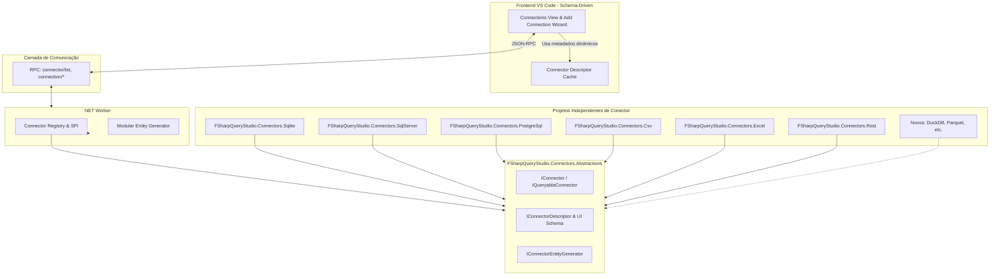

# Change Proposal: Modularização Desacoplada de Conectores (Micro-Kernel & Plugin SPI)

## Intent Block
```text
Intent Block:
Goal:        Desacoplar totalmente a arquitetura de conectores no F# Query Studio, permitindo que novos conectores de dados sejam desenvolvidos, testados e plugados de forma independente e isolada, sem necessidade de alterações no código-fonte da extensão VS Code nem modificações no núcleo do Worker.
Expectation: O desenvolvedor pode criar um novo conector como um módulo .NET isolado (implementando IConnector e IConnectorDescriptor), enquanto o VS Code renderiza a interface de configuração dinamicamente a partir de metadados declarativos expostos pelo Worker, sem switches imperativos ou tipos hardcoded em TypeScript.
Action:      (1) Dividir o monólito FSharpQueryStudio.Connectors em um núcleo de abstrações (FSharpQueryStudio.Connectors.Abstractions) e projetos isolados por conector (Sqlite, SqlServer, PostgreSql, Csv, Excel, RestJson); (2) Criar um Connector Registry dinâmico com SPI (Service Provider Interface); (3) Desacoplar a geração de entidades em geradores modulares por conector; (4) Tornar o ConnectorKind extensível no Protocolo e introduzir a chamada RPC `connector/list` com descritores de UI declarativos; (5) Refatorar a extensão VS Code para consumir os descritores declarativos, tornando os formulários de adição/edição de conexão 100% orientados a metadados (Schema-Driven).
Result:      Arquitetura zero-acoplamento vertical: novos conectores podem ser adicionados sem tocar na extensão VS Code, sem inflar o runtime principal com dependências cruzadas e com isolamento total de testes e dependências externas.
```

## Contexto & Motivação Atual

Atualmente, a arquitetura de conectores do F# Query Studio apresenta acoplamento rígido em todas as camadas:

1. **Monólito .NET (`FSharpQueryStudio.Connectors.fsproj`)**:
   - Um único projeto agrega todos os 6 conectores (`Sqlite`, `SqlServer`, `PostgreSql`, `Csv`, `Excel`, `RestJson`), o gerador de entidades (`EntityBackgroundGenerator`), o gerador de dados de exemplo (`SampleDataGenerator`) e o pushdown SQL.
   - Referencia simultaneamente todos os pacotes pesados (`Microsoft.Data.SqlClient`, `Npgsql`, `Microsoft.Data.Sqlite`, `ClosedXML`, `SQLProvider`).
   - Consequência: binários gigantescos, tempo de compilação longo, impossibilidade de criar ou testar um conector isoladamente e risco de conflitos de dependências transitivas.

2. **Discriminated Union Fechado no Protocolo (`ConnectorKind`)**:
   - `ConnectorKind` é um enum/union fechado (`SqlServer | PostgreSql | Sqlite | Csv | Excel | RestJson`).
   - Adicionar qualquer novo conector (ex.: `DuckDB`, `Parquet`, `ClickHouse`, `MongoDB`) quebra o protocolo e exige alterar `FSharpQueryStudio.Protocol`.

3. **Pattern Matching Rígido no Runtime**:
   - `WorkspaceConnectionResolver.fs` possui um `match definition.Kind with` hardcoded.
   - `EntityBackgroundGenerator.fs` possui type tests imperativos (`:? IQueryableConnector`, `:? CsvConnector`, `:? ExcelConnector`, `:? RestConnector`).

4. **Acoplamento Extremo na Extensão VS Code (TypeScript)**:
   - `protocol.ts` define `ConnectorKindName` fixo.
   - `commands.ts` define a lista de conectores em um array estático (`KIND_PICKS`).
   - `add.ts` e `definition.ts` contêm switches e condicionais imperativos (`if (kind === "Sqlite" || kind === "Csv" ...)`) para coletar inputs do usuário, formatar strings de conexão e extrair senhas.
   - Toda adição de conector exige modificar 4 a 5 arquivos TypeScript na extensão.

---

## Nova Arquitetura Proposta: Micro-Kernel & Plugin SPI



### 1. Núcleo de Abstrações (`FSharpQueryStudio.Connectors.Abstractions`)
Biblioteca leve, sem dependências de bancos ou drivers externos:
- `IConnector`: identidade, `TestConnectionAsync`, `DiscoverSchemaAsync`.
- `IQueryableConnector` e `IStreamingQueryableConnector`: suporte a queries diretas e streaming.
- `IConnectorEntityGenerator`: contrato para emissão de código F# tipado em `GeneratedEntities.fs`.
- `ConnectorDescriptor`:
  - `Id`: identificador único (string, ex.: `"sqlserver"`, `"sqlite"`, `"csv"`).
  - `DisplayName`: nome amigável (ex.: `"SQL Server"`, `"SQLite"`).
  - `Category`: categoria de acesso (`Sql`, `TabularFile`, `Rest`, `Custom(string)`).
  - `Icon`: nome do ícone (ex.: `"database"`, `"file-text"`).
  - `FormFields`: lista declarativa de campos para o VS Code:
    - `Name`: chave na configuração JSON (ex.: `"filePath"`, `"connectionString"`, `"delimiter"`).
    - `Label`: texto de exibição.
    - `Type`: `"string" | "file" | "password" | "select" | "boolean"`.
    - `Required`: booleano.
    - `Placeholder`: texto de exemplo.
    - `DefaultValue`: valor padrão opcional.
    - `Options`: opções para selects (ex.: Windows vs SQL Auth).
    - `SecretHandling`: indica se o campo deve ser armazenado no cofre de segredos (`SecretStore`) via placeholder `{password}`.
- `IConnectorFactory`: constrói instâncias do conector a partir de `JsonElement` e `ISecretStore`.
- `ConnectorRegistry`: registro thread-safe de conectores descobertos ou registrados.

### 2. Decomposição dos Conectores em Módulos Independentes
Cada conector passa a ser um projeto de classe F# isolado:
- `FSharpQueryStudio.Connectors.Sqlite.fsproj` (referencia apenas `Microsoft.Data.Sqlite`).
- `FSharpQueryStudio.Connectors.SqlServer.fsproj` (referencia apenas `Microsoft.Data.SqlClient`).
- `FSharpQueryStudio.Connectors.PostgreSql.fsproj` (referencia apenas `Npgsql`).
- `FSharpQueryStudio.Connectors.Csv.fsproj` (parser nativo, zero dependências externas).
- `FSharpQueryStudio.Connectors.Excel.fsproj` (referencia apenas `ClosedXML`).
- `FSharpQueryStudio.Connectors.Rest.fsproj` (referencia apenas `System.Net.Http`).
- `FSharpQueryStudio.Connectors.fsproj`: atua como aggregate/composition root padrão do Worker, registrando todos os conectores nativos no `ConnectorRegistry`.

### 3. Protocolo Extensível
- `ConnectorKind`: passa a aceitar identificadores de string aberta (`ConnectorKind.Custom of string` ou union extensível com conversão transparente de/para string).
- Novo método RPC `connector/list`:
  - Retorna `ConnectorDescriptorDto[]` contendo id, displayName, category, icon e formFields.
  - Permite que a extensão receba a lista completa de conectores disponíveis no Worker em tempo de execução.

### 4. VS Code Orientado a Metadados (Schema-Driven)
- `add.ts` e `commands.ts` são refatorados:
  - O comando "Add Connection" chama `connector/list` do Worker (com cache local).
  - O QuickPick exibe dinamicamente os conectores retornados.
  - A coleta de campos do formulário itera sobre `descriptor.formFields`:
    - Para `type: "file"`, exibe seletor de arquivo ou input de caminho.
    - Para `type: "select"`, exibe QuickPick com as opções.
    - Para `type: "password"`, oculta texto e marca para o `SecretStorage`.
    - Para `type: "string"`, exibe InputBox com validação de obrigatoriedade.
  - A sanitização e guarda de senhas ocorre automaticamente baseada no metadado `secretHandling`.
- **Resultado no VS Code**: zero linhas de código TypeScript necessárias para suportar um novo conector!

---

## Escopo Detalhado

### In Scope
1. Criação do projeto `FSharpQueryStudio.Connectors.Abstractions` com interfaces de conector, gerador de entidades e schema declarativo de UI.
2. Criação do `ConnectorRegistry` no backend.
3. Separação dos conectores em projetos isolados (.NET / F#):
   - `Sqlite`, `SqlServer`, `PostgreSql`, `Csv`, `Excel`, `Rest`.
4. Implementação do descritor de UI declarativo para cada um dos 6 conectores nativos.
5. Suporte a `connector/list` no protocolo JSON-RPC e no Worker `Handlers.fs`.
6. Refatoração do `WorkspaceConnectionResolver` e do `EntityBackgroundGenerator` para consultar o `ConnectorRegistry`.
7. Refatoração do frontend VS Code (`editors/vscode/src/connections/`) para consumir `connector/list` e renderizar wizards de conexão orientados a metadados.
8. Preservação de 100% da compatibilidade de `workspace.json` existente e das APIs de notebook (`Connections.sql.*`, `Connections.csv.*`, etc.).
9. Testes unitários e de integração cobrindo cada módulo de conector isoladamente e o fluxo declarativo do VS Code.

### Out of Scope
- Implementação de novos conectores terceiros neste ciclo (ex.: Parquet, DuckDB) — o foco desta proposta é construir e consolidar a infraestrutura e arquitetura desacoplada.
- Alteração do mecanismo de persistência de credenciais no SO (`ISecretStore` / `SecretStorage`).

---

## Fases de Execução

1. **Fase 1: Abstrações & SPI Core (.NET)**
   - Criar `FSharpQueryStudio.Connectors.Abstractions`.
   - Definir `IConnectorDescriptor`, `ConnectorFormField`, `IConnectorEntityGenerator`, `ConnectorRegistry`.
2. **Fase 2: Modularização dos Projetos de Conector**
   - Criar os projetos individuais para cada conector e mover o código e dependências NuGet específicas.
   - Manter `FSharpQueryStudio.Connectors` como composition root para não quebrar referências da solução.
3. **Fase 3: Protocolo & Worker Handlers**
   - Implementar método `connector/list` no Worker.
   - Tornar resolução e background generation dirigidas pelo `ConnectorRegistry`.
4. **Fase 4: Frontend VS Code Schema-Driven**
   - Adaptar `protocol.ts` para receber os descritores.
   - Refatorar `add.ts`, `definition.ts` e `commands.ts` para renderização orientada a schema.
5. **Fase 5: Validação, Testes & CI**
   - Testes unitários de cada projeto modular.
   - Testes no VS Code com mocks de descritores.
   - Execução da suíte completa local e no container Linux (`docker run`).

---

## Success Criteria
- [ ] O projeto `FSharpQueryStudio.Connectors.Abstractions` compila de forma limpa, sem dependências de pacotes de banco de dados externos.
- [ ] Cada conector nativo (Sqlite, SqlServer, PostgreSql, Csv, Excel, Rest) possui seu projeto isolado e testes independentes.
- [ ] O Worker responde ao método `connector/list` retornando metadados declarativos completos dos conectores registrados.
- [ ] O fluxo de adição e edição de conexões no VS Code é 100% orientado aos descritores dinâmicos, sem condicionais hardcoded por conector em TypeScript.
- [ ] Compatibilidade preservada: notebooks existentes e arquivos `workspace.json` continuam funcionando sem necessidade de alteração ou migração.
- [ ] Todos os testes automatizados (.NET e TypeScript) passam com 100% de sucesso localmente e no container Linux.
